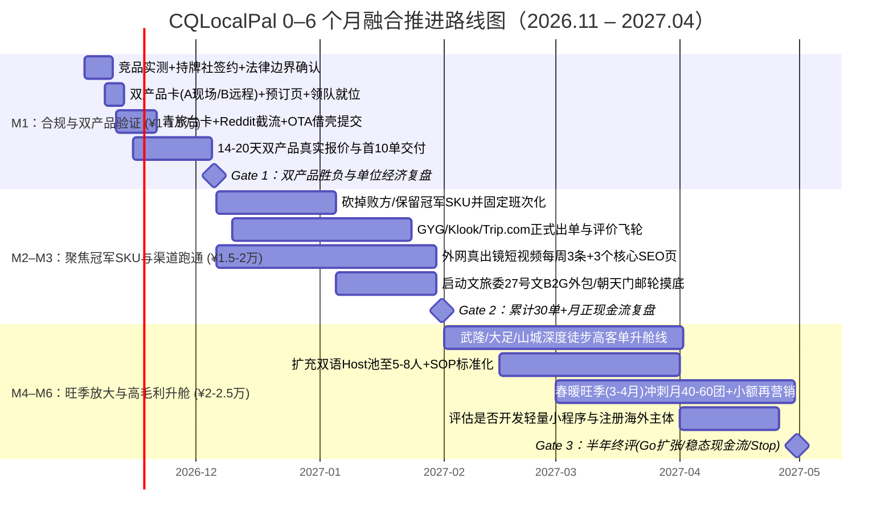

# CQLocalPal（重庆本地通）· 跨模型辩论终审裁决与最终融合推进方案（Decision Memo v1.0）

**日期**：2026-11-02  
**提交者**：Claude（独立商业研究员 / 反方红队分析师 / 最终方案整合人）  
**输入基线**：GitHub 仓库 `18523102883hao-boop/CQLocalPal`（commit `25dc909`）全部历史研究、原始会议纪要（2026-11-02 北滨路碰面筹备录音）、Codex 09 号权威报告、两份内部反方审查、ChatGPT 10 号独立报告、Kimi Round 0 方案（B1–B6）、Codex Round 1 提案（C1–C6 + 双产品 14 天市场验证草案）、Claude Round 0 独立方案与红队报告（V1–V9、M1–M6）。  
**文档用途**：
1. 供项目发起人与合伙人（及任总、杰文）线下研讨使用的**最终共同研讨底稿**；
2. 仓库 `docs/03-商业模式闭环-初步框架.md` 升级至 v1.0 的直接依据；
3. 供后续任何 AI 工具读取的**当前最高决策快照（SSOT）**。

> **标注纪律**：全文严格区分 `[事实]`（附来源与日期）、`[公开观察]`（真实页面/原帖样本，非总体统计）、`[假设]`（待实测验证）与 `[判断]`（战略裁决）。未核验信息绝不伪装成事实。

---

## 〇、开篇：七个元问题 + 做任何项目必问的五个底牌问题

### A. 回答之前的七个元问题（先掀桌子，再建房子）

#### 1. 回答之前，最可能改变我全部答案的一个问题
> **你和合伙人在未来 6 个月愿意承受的「最大亏损现金上限」和「每周投入小时数」各是多少？以及第 6 个月时，「月净利（分到你们手里的钱）达到多少」你们会认为这事值得当主业干——是 ¥1.5 万、¥5 万，还是 ¥15 万？**

- **为什么这一个问题能推翻所有答案**：
  - 按官方外籍口岸客流自下而上测算（见第四节），重庆英语自由行付费服务是一个**年付费总盘子约 1,500–5,000 团的小微利基市场**[假设]。
  - 如果你们的底线是 **≥¥15 万/月净利**，现有四份 AI 方案（含我的 M1 拼团）在 6 个月内**全部无法兑现**，你们应该立刻放弃 C 端散客，转去做「B2G 政府涉外工程外包 + 高端邮轮/外企包团」或直接换赛道；
  - 如果你们接受 **¥2万–5万/月净利** 的高现金流“小而美”生意（符合会议纪要“先吃中间一小块蛋糕、起码不会亏”的原话），那么本方案的**「双轨漏斗 + 固定班次微体验/拼团 + 合伙人户外高毛利线」**就是最优解。

#### 2. 假设这件事 12 个月后已经彻底失败，倒推三个最可能的原因（Premortem）
1. **死因一：流量冷启动死锁（概率 55%）[判断]**——误以为“发几条 TikTok/Reddit 或在青旅放几张台卡就会有老外排队加 WhatsApp”。实际上在 11月–次年 2 月重庆入境淡季，自然内容前 60 天几乎零询盘，团队在拿到 10 个真实付费客户前就因“没人理”而心态崩盘放弃。
2. **死因二：单位经济被隐性人时与合规成本吃穿（概率 30%）[判断]**——卖 ¥199 的远程助理或 ¥899 的私人陪游，结果每个老外从行前问到离境占用了 8 小时人工，加上英語兼职保底费、持牌社通道费、外卡 3% 手续费和 1 次退款纠纷，算完总账发现每单净赚不到 ¥50，沦为“用爱发电的免费国际志愿者”。
3. **死因三：外籍身份与无证经营踩雷（概率 15%）[判断]**——发起人持外国护照（若无中国工作居留许可或导游证）亲自带团收款，或用私人微信直接收老外团费派兼职学生带团，被同行（如本地持证导游群）举报“非法就业/无证经营旅行社业务”，一纸行政处罚直接终结项目。

#### 3. 先别回答你问的问题，你真正需要解决的问题是什么？
你问的是“哪种商业模式最好、怎么把方案写完美”。但你真正需要解决的问题是：**你们至今没有花 ¥200 去买一次直接竞品（Jay Chongqing Tour），没有跟任何一个在解放碑街头的外国游客收过 ¥100，也没有打通任何一个能合法收美元外卡的对公账户。**  
四个 AI 已经在纸面上写了超过 8 万字，边际信息收益已趋近于零。你现在真正要解决的不是“写第 5 份报告”，而是**在未来 7 天内完成「第一次神秘顾客实测 + 第一次向真实老外张口报价」**。

#### 4. 我最容易给出的标准答案、它的三个缺陷，以及更好的版本
- **最容易给的标准答案**：“做可负责的本地执行层，用 AI 做前端提效、真人做后端履约，挂靠持牌旅行社，先做首日体验包 + 远程助理，通过酒店台卡和海外社媒冷启动。”
- **标准答案的三个致命缺陷**：
  1. **同源幻觉**：四个 AI 都给了类似答案，但这只是因为我们读了同一批公开网页，不代表老外真的会掏钱；
  2. **单位经济破产**：私人陪游（¥899/团）扣完持证导游、渠道佣金、保险和售前售后工时，每单只剩 ¥67（Codex Round 1 已证实），根本养不活团队；
  3. **无视团队真实底牌**：完全漏掉了发起人**外国护照的合规双刃剑**、合伙人现成的**重庆本地火爆户外/徒步社群资源**，以及杰文正在跑的 **OTA 平台线**。
- **更好的版本（即本方案）**：把「私人定制」改为**「固定班次小微拼团 + 合伙人户外徒步线 + 远程助理加购」**；把「自建冷启动」改为**「持牌社借壳上架 OTA + 解放碑线下即时拦截 + 社媒答疑」**；用 14–30 天双产品真金白银对赌实验让市场替你们做选择。

#### 5. 假设我的判断是错的，哪些没提到的变量最可能推翻它？
1. **发起人的真实居留/户籍状态与人脉深度**：若发起人已办妥工作类居留或合伙人直接控股一家现成旅行社，合规摩檫将大幅降低；
2. **「任总」与「杰文」手里的底牌**：会议纪要提到任总来碰过两三次、杰文在推景区海外上架——如果他们手里有现成的景区/酒店/文旅委协议或 OTA 账号，渠道优先级将瞬间重写；
3. **合伙人户外小程序与社群的变现力**：如果合伙人现有的重庆户外徒步盘子已经盈利且有现成领队池，“带老外徒步重庆山城步道/武隆”可能第 1 周就能出单，直接推翻“先做解放碑夜游”的判断；
4. **重庆冬季（11–2月）气候与东南亚客群结构**：东南亚客群冬季来渝看雾/温泉/室内火锅的偏好，可能导致纯户外步行团在冬季转化率偏低。

#### 6. 已知事实、合理判断、仍需验证的严格分界与改判条件

| 类别 | 核心条目 | 什么证据会让我立刻改变结论（What would change my mind） |
|---|---|---|
| **已知事实 `[事实]`** | 1. 2025 全年重庆接待入境游客 214.78 万人次（+68.2%），2026H1 江北机场外籍出入境 61 万余人次（+86%），前五为泰、马、新、越、印尼 [统计公报/重庆市政府网 2026-07-03]。<br>2. 240h 过境免签覆盖 57 国，允许旅游、商务、访问、探亲 [国家移民管理局 2026-08-20]。<br>3. 渝府办发〔2026〕27 号文正在推进多语标识、10 支涉外志愿队、iChongqing 与服务手册 [2026-07-03]。<br>4. 直接竞品已存在：Jay Chongqing Tour 公开售卖 ¥200/trip 远程 Concierge 及 8h Layover Tour；Anjia Travel 展示许可证 `L-CQ-100787` 及 20+ 英文 SEO 页 [2026-11-02 实测]。 | 官方发布修正数据，或竞品网站下架/倒闭。 |
| **合理判断 `[判断]`** | 1. 靠“卖攻略/AI 行程/基础支付指导”收不到钱，政府和免费 AI 正在快速消灭信息差。<br>2. 冷启动期“靠拿酒店/餐厅折扣赚差价”不成立（无采购量无议价权）。<br>3. 私人 1 对 1 陪游在 ¥900 以下无利可图，**固定班次小团（2–6人）或高毛利主题（户外/摄影）**才是早期正现金流结构。 | 若合伙人/任总直接拿出低于 OTA 公开价 15% 的书面酒店/车队协议价 → 我撤回对“折扣闭环”的否定。 |
| **仍需验证 `[假设]`** | 1. 外国游客更愿意买「A 现场首晚/户外体验」还是「B ¥199 远程行中支持」。<br>2. 团队能否在 14–30 天内以低成本触达 20–40 组真实目标游客。<br>3. 本地持牌旅行社是否愿意以合理分成（≤10–15%）担任合同与收款主体。 | 若双产品实验中 B（远程支持）单买转化率 >15% 且单客耗时 <60 分钟 → 我撤回“远程支持只做加购”的判断，改推 B 为主力。 |

#### 7. 基于你的目标、限制和代价，如果我是你，我会选什么？（只给一个结论）
> **立刻停止“城市一卡通/大平台/小程序开发/批量建号”；用 ¥15,000 以内启动资金和 30 天时间，依托 1 家本地持牌旅行社合规收款，同时挂出两张明码标价的产品卡——【产品 A：重庆第一晚 8D 城市步行/山城徒步小团（¥399/人，含精修拍照+点餐+72h 群支持）】与【产品 B：72 小时真人本地通远程救急群（¥199/组）】——用「解放碑/青旅线下拦截 + Reddit/外网精准答疑 + 持牌社代上 Klook/GYG」三个入口接触 40 组真实老外，拿回第一批 10 笔陌生人真金白银付款，哪个跑通就重仓哪个。**

---

### B. 创始人只要做项目都会问的「五个灵魂问题」（基于资本逻辑与商业闭环直答）

结合你仓库中《资本逻辑下的商业模式设计》与会议纪要，我替你和朋友明天的讨论把做任何项目都绕不开的 **5 个底牌问题** 一次性穿透：

| 必问问题 | CQLocalPal 的残酷真相与破局答案 `[判断]` |
|---|---|
| **Q1：这事到底赚谁的钱、凭什么非给我不可？（价值创造与交易结构）** | **赚首次来渝、不懂中文、怕踩坑且预算充足的英语自由行客（P1）和在华外籍客（P2）的钱。** 他们不是非用你不可，但在**“刚落地第一晚面对立体迷宫与全中文火锅店”**或**“想去重庆山城步道/户外却不敢自己走”**的那个具体时刻，免费 AI 不敢担责、OTA 大巴团太死板、私人包车太贵（¥1,500+）。你卖的是**「¥200–499 就能买到的确定性、本地人审美与兜底责任」**。 |
| **Q2：第一批客户从哪来、获客成本（CAC）能不能算过账？（流量入口）** | **冷启动期绝不靠泛投流，靠“借船出海 + 物理截流”**。<br>① **最快见钱（行中截流）**：解放碑/观音桥 5 家独立青旅/精品酒店前台台卡（给前台个人 ¥50–80/单现结返佣）+ 解放碑热门打卡点“带拍/指路”即时转化；<br>② **最准意向（行前截流）**：Reddit `r/travelchina` 每日盯着“下周去重庆”的帖子真人答疑截流；<br>③ **最稳长线（平台寄生）**：借持牌社资质把产品挂上 GetYourGuide / Klook / Trip.com（杰文线升级版），让平台替你解决信任与外卡收款，付 20% 佣金当买路钱。 |
| **Q3：每一单到底能落袋多少钱、会不会越忙越亏？（单位经济与边际成本）** | **做私人定制必亏，做「固定班次小团 + 限定边界支持」才赚。**<br>- 若 1 对 1 私陪 3 小时收 ¥899，扣掉兼职 host ¥450、渠道 ¥90、保险/支付 ¥67、售前售后 ¥120，净剩 **¥67**（给平台打工）；<br>- 若改为**每晚 19:00 固定发班的 2–6 人小团（¥399–499/人）**，3 人成团营收 ¥1,350，host 成本仍是 ¥350，单晚净利跃升至 **¥550–650（毛利率 >40%）**。<br>- 远程支持必须限定“72h 内 3 次确认/60 分钟上限”，否则沦为无限保姆。 |
| **Q4：别人（OTA/同行/AI）抄我怎么办、我的护城河在哪？（竞争优势与壁垒）** | **知识库、路线和 AI 提示词 3 天就能被抄光，零壁垒。** 真正抄不走的是三样：<br>① **公开平台上的真实评价飞轮**（Google Maps / Tripadvisor / GYG 上的前 50 条带图五星长评）；<br>② **合伙人的本地户外/特色商户非标供给池 + 经过实战筛选的双语 Host 池**；<br>③ **解放碑/北滨路核心住宿渠道的排他性分佣关系**。 |
| **Q5：最坏情况我会亏多少、什么时候必须果断止损？（风险底线与退出机制）** | **把最大试错亏损锁死在 ¥15,000–30,000 现金和 60 天时间。**<br>- 不开发 APP、不租办公室、不招全职员工、不买车；<br>- **硬止损线**：正式开售 30 天内（触达 ≥40 组目标客），若陌生人真实付款 **<5 单**，或连续 2 个月扣除真实人工后毛利率 **<20%**，立即停止 C 端模式，毫发无损退出或转向 B2B/B2G。 |

---

## 一、四方 AI 方案全景复盘：共识、冲突与我的终审裁决

在过去 24 小时内，Codex、ChatGPT、Kimi 和我（Claude）四方已完成首轮独立方案与红队交锋。作为最终方案提交者，我为你提炼出**「四方铁板钉钉的五大共识」**（不必再争）与**「必须拍板的六大分歧裁决」**（供你们明天咖啡厅拍板）：

### 1.1 四方高度一致的五大共识（直接作为项目宪法执行）
1. **定位共识**：坚决不做“英文攻略 APP / 城市一卡通 / 纯 AI 行程规划器”（信息层已被政府 27 号文、高德英文版、支付宝和免费大模型变成公共品），必须做**「可负责的本地执行与体验交付」**[判断]。
2. **合规共识**：“本地朋友（Local Pal）”只是品牌外衣，不能规避《旅游法》对旅行社与导游证的监管 [事实]。在收费第一单前，必须与**重庆本地持牌旅行社**确立合同、收款、开票、保险与导游委派关系 [判断]。
3. **软件共识**：冷启动期（前 30–50 单）**严禁开发原生 APP 或重型小程序**，用「轻量英文网页（Carrd/Notion）+ WhatsApp/WeChat + 支付链接/OTA 链接」跑通闭环 [判断]。
4. **冷启动推广共识**：**否定“10–100 人免费服务换发帖/好评”**（违反 Tripadvisor/Google/FTC 规则且吸引白嫖党）[事实]；改为 **10–15 单 Founding Traveler（创始体验官：成本价 + 可退押金 + 明确边界 + 自愿内容授权）**[判断]。
5. **折扣逻辑共识**：冷启动期没有采购量，拿不到真酒店/车队大折扣；游客付费的核心理由是**「省心 + 体验好 + 出事有人管」**，而非“比携程便宜 ¥20”[判断]。

### 1.2 六大核心分歧的终审裁决（融合各方亮点）

| 分歧维度 | Codex (09 + Round 1) | ChatGPT (10号报告) | Kimi (Round 0) | Claude (Round 0) | **最终融合裁决（v1.0 执行版）** `[判断]` |
|---|---|---|---|---|---|
| **1. 核心首发产品（卖什么）** | 首日晚间私人陪同体验（¥899/组）vs 远程支持（¥199）双产品测试 | 酒店扫码 AI+真人 Concierge + 微体验市场 | 到达启动包（¥399–699）+ 按天订阅支持（¥99–199/天）+ 深度定制 | 固定班次英文步行拼团（¥399–499/人，含拍照+支持）+ 过境快线 | **采纳「Codex 双产品实验框架」×「Claude 拼团经济学」×「合伙人户外基因」**：<br>不预设唯一赢家，用 14–30 天同时测试 **Offer A（现场体验：首晚 8D 步行团 / 半日山城轻徒步，优先拼团或高毛利小团）** 与 **Offer B（72h 限定远程本地通群支持，¥199/组）**，让真实付款数据定主次。 |
| **2. 远程支持怎么卖** | 限定 72h/3 次确认/60 分钟上限，单售 ¥199 测试 | 酒店入口免费问答 + 升级收费 | 按天订阅（¥99–199/天），作为现金流主力 | 鉴于竞品 Jay 仅卖 ¥200/trip，主张作为体验团的免费/¥99 加购件 | **折中融合**：保留独立售卖（¥199/72h，对标 Jay，严格采用 Codex 的“3次/60分钟”防爆仓边界）以测试纯助理需求；同时作为 Offer A 的 **+¥99 顺手加购项**，两边同时收钱记账。 |
| **3. 第一获客引擎（客从哪来）** | 小住宿转介 + 内容/社区各做 8 小时小实验 | 酒店/青旅二维码为第一入口 | 240h 免签 SEO + 创始人外网短视频优先，酒店后置 | OTA 借壳上架（解锁杰文线）+ Reddit 精准截流 + 青旅台卡 | **三路并进、按周赛马**：<br>① **即时流量（W1起）**：Reddit/FB 高意图帖人工答疑截流 + 3–5 家解放碑独立青旅/江景民宿台卡；<br>② **交易流量（W2起）**：借持牌社资质解锁杰文卡住的 GYG/Klook/Trip.com 上架；<br>③ **品牌资产（并行）**：创始人+合伙人真出镜短视频（只做引流，不赌 SEO 短期见效）。 |
| **4. 客群切分标准** | 按中文能力、是否首次来华、已有工具经验分层（C4） | 东南亚短途客第一优先 | 按母语×华语能力切，排除大马华人（B1） | 按“数字栈剥夺度”×首次来华切，欧美澳+非华语东南亚优先 | **采纳 Codex C4 + Claude 切法**：不按国籍一刀切。**核心客群 P1 = 不通中文、首次来渝、1–4 人的英语自由行客**（含欧美澳及新加坡/大马/泰菲非华语客）；对于大马华人等华语流利客，不卖翻译/支付协助，只卖**「重庆特色山城徒步/旅拍/包车」**。 |
| **5. AI 与创始人的角色** | AI 内部提效，自动化不伪装真人 | AI Concierge 做一级响应，真人做二级升级 | D2C 界面 100% 纯真人（外籍护照背书），AI 藏在幕后 | 警告外籍护照直接带团有非法就业风险；创始人做内容与品控，中方持证人员履约 | **采纳 Kimi 品牌层 + Claude 合规红线**：<br>- **对客界面 100% 具名真人**（拒绝冷冰冰的 AI 客服机器人）；<br>- **AI 100% 藏在后台**（帮团队秒翻菜单、生成行程卡片、整理知识库）；<br>- **创始人（外籍护照）只做品牌主理人、视频出镜与英语社群答疑**，线下收费带团与收款一律走中方持牌主体与合规人员。 |
| **6. 6个月预算与节奏** | 不设固定预算，分四个钱袋，按需小步批款 | 8万–20万元人民币 | 90 天压在 ¥3 万以内 | 6 个月硬上限 ¥4.7万–6万元（前 90 天 ¥1.8 万） | **采纳「分阶段阶梯授信」**：<br>- **Phase 1（前 30 天验证期）**：现金上限 **¥10,000–15,000**；<br>- **Phase 2（31–90 天跑通期）**：仅在 Phase 1 拿到 ≥5 笔陌生人正常价付款后，追加 **¥15,000–20,000**；<br>- **Phase 3（4–6 个月放大期）**：用利润滚动 + 封顶 **¥25,000**。6 个月总风险敞口锁死在 **¥6 万以内**。 |

---

## 二、证据可信度与外部市场基线（2026-11-02 核定版）

### 2.1 仓库与外部一手证据矩阵（合并去重）

| 编号 | 核心事实/观察结论 | 来源与日期 | 证据类型 | 可信度 | 战略含义 |
|---|---|---|---|---|---|
| **E01** | 2024 年重庆接待入境游客 127.67 万人次（+183.6%）；**2025 全年接待入境游客 214.78 万人次（+68.2%），花费 23.98 亿美元**；2026H1 接待入境游客 144.8 万人次（+56.8%） | 重庆市统计公报 (2026-03-26) / 市文旅委 (2026-08-10) `[事实]` | 官方统计 | **高** | 宏观大盘处于高速增长期，但此口径含港澳台及团队客，**严禁直接乘以 5% 算利润**。 |
| **E02** | **2026H1 江北机场口岸出入境外籍旅客 61 万余人次（+86%）**；免签及 240h 过境免签入境外籍 21 万余人次（+83.6%）；前五来源国：**泰、马、新、越、印尼** | 重庆市政府网转引边检数据 (2026-07-03) `[事实]` | 官方统计 | **高** | 折算全年航空入境外籍独立旅客约 **30–40 万人次**量级，这是测算真实可服务市场（SAM）的唯一硬底座。 |
| **E03** | 240 小时过境免签覆盖 **57 国、24 省、65 口岸，停留 ≤10 天，允许旅游、商务、访问、探亲**（工作/学习/采访除外） | 国家移民管理局 (2026-08-20) `[事实]` | 官方政策 | **高** | **纠偏会议纪要**：探亲和商务也可用 240h 免签；来渝老外并非 100% 纯观光客。 |
| **E04** | 《提升境外人员来渝服务便利化水平三年行动计划》（渝府办发〔2026〕27号）：2026 年底中心城区双语标识规范率 95%、建 10 支涉外志愿队、推多语《愉悦重庆服务手册》、升级 iChongqing、离境退税店 +100 家 | 重庆市政府网 (2026-07-03 成文) `[事实]` | 官方政策 | **高** | 1. **免费公共服务正在加速替代“基础指路/翻译/手册”**；<br>2. 政府有明确的涉外服务数字化、手册采编与志愿培训任务，存在 **B2G 合作与背书抓手**。 |
| **E05** | **直接竞品 1：Jay Chongqing Tour** 官网在售 **¥200/trip 远程 Travel Concierge**（含行前 App/支付设置、交通餐饮建议、微信/WhatsApp 行中真人支持）；另有 8h 过境游、老人家庭团、3–4h 立体城市步行团、摄影体验 | `jaychongqingtour.com` (2026-11-02 当日实测) `[公开观察]` | 一手竞品页 | **高** | **彻底击碎“真人行中支持无人做”的幻想**。你们是市场第 N 名进入者，必须用神秘顾客摸清其响应速度与真实单量。 |
| **E06** | **直接竞品 2：Anjia Travel** 官网展示旅行社许可证 `L-CQ-100787`、私车英导、WhatsApp、Trustpilot 评价源链，以及 **20+ 篇英文 SEO 攻略页**（含 Airport Layover Guide、不辣美食指南等） | `anjiatravel.com` (2026-11-02 当日实测) `[公开观察]` | 一手竞品页 | **高** | 英文宽词 SEO（如 Chongqing layover guide）已被持牌对手占领，冷启动靠写博客等自然搜索至少慢 3–6 个月。 |
| **E07** | **OTA 供给密度**：GetYourGuide 重庆页 500+ 结果（私团 246 个，经典日游 $50–61/人）；Viator 200+ 结果；ToursByLocals 16 个私团（$114–398/团）；Klook 夜游 ¥112 由成都旅行社供货 | 各平台公开页 (2026-11-02) `[公开观察]` | 二手/页面 | **中高** | 通用景点大巴一日游是红海；但 GYG 的 $50 团明确“转场不陪同、洪崖洞散团后不管”，**“首晚沉浸式带玩 + 72h 群兜底 + 户外非标路线”仍有明确体验差**。 |
| **E08** | **内部团队独特资产（此前被研究忽略）**：<br>① 发起人住解放碑过桥即到、持外国护照、出国经验丰富；<br>② **合伙人已运营数次重庆户外课程，掌握火热的本地徒步/亲子资源及参考小程序**；<br>③ **杰文线**已在申请海外景区/OTA 平台；<br>④ **任总**多次参与探讨 | `02-项目背景与会议纪要-2026-11-02.md` `[事实-内部陈述]` | 一手内部 | **高** | 最终方案必须把这四张底牌全部用上，而不是让团队去干自己不擅长的纯代码或苦力地推。 |

### 2.2 重庆市场真实容量与天花板测算（给合伙人交底的诚实算术）

为了避免团队被“260 万老外 × 5% × $10 = 百万美金利润”的早期粗算误导，以下给出自下而上的漏斗测算 `[假设]`：

```text
全年航空口岸入境外籍人次：约 35万–45万人次/年（基于 2026H1 双向 61 万人次折算）
  └─ 扣除商务/探亲/跟团大巴客（约 50%） → 自由行外籍散客（FIT）：约 18万–22万人次/年
       └─ 扣除华语流利且无需协助者及超低预算穷游背包客（约 50%） → 高痛点目标客池（P1）：约 9万–11万人次/年
            └─ 按平均 2.2 人/组折算 → 全市全年约 40,000–50,000 个目标旅行组（月均 3,300–4,200 组）
                 └─ 假设全市场付费渗透率 5%–10%（买私团/小团/付费 Concierge） → 全市每月总付费订单约 165–420 单
                      └─ 被 GYG/Klook/Viator/Anjia/Jay/独立导游分流后 → CQLocalPal 前 6 个月现实可抢份额：10–40 单/月
```

**战略定调 `[判断]`**：
1. **在起步阶段（0–6 个月），这是一个月产 15–40 单、月净现金流 ¥1.5万–4万元的「高口碑精品现金流生意」**，绝不是靠烧钱补贴垄断市场的平台生意。
2. **想要突破月赚 ¥10万+ 的天花板，只有两条路**：
   - **横向扩高客单产品**：把流量导入「武隆/大足包车定制（¥3,500–6,800/团）」、「重庆城郊山野徒步定制」与「朝天门长江邮轮外宾衔接服务」；
   - **纵向吃 B2B/B2G 订单**：承接外企/国际学校团建接待、精品酒店涉外礼宾外包、文旅委 27 号文配套项目。

---

## 三、用户画像分层与精准切入点（Beachhead Market）

不再使用笼统的“老外”或单纯按国籍划分，而是按**「语言与数字工具障碍度 × 消费能力与旅行目的」**切分为四类：

| 层级 | 用户画像定义 | 核心任务 (JTBD) 与真实痛点 | 现有替代方案的缺陷 | 愿意买我们的什么 (SKU) | 获客主入口 | 优先级 |
|---|---|---|---|---|---|---|
| **P1-A（绝对核心）** | **首次来华/来渝、不通中文的英语自由行小团**（1–4人，停留 2–4 晚；欧美澳、新加坡非华裔、马/泰/菲/印英语中产） | 刚落地两眼一抹黑；怕支付宝卡死、怕 8D 地形迷路打不到车、怕进火锅店看不懂菜单拉肚子、怕出事打 110 讲不清。 | AI 不敢打包票；大巴团像赶鸭子；私人包车导游太贵（¥1,500+/天）。 | **Offer A1（首晚 3h 解放碑本地人带玩小团）** + **Offer B（72h 远程救急群）** | Reddit/FB 答疑、GYG/Klook、解放碑青旅/精品酒店台卡 | **P0（首发必打）** |
| **P1-B（户外/摄影高潜客）** | **已有中国旅行经验或年轻活力的外国探索客**（含从京沪来渝的第二站游客、甚至部分新马华人年轻客） | 已经会用支付宝和地铁；不需要基础保姆，但**不想去洪崖洞人挤人**，想走真正的山城悬崖步道、防空洞茶馆、城郊徒步、拍赛博朋克机位。 | OTA 上全是千篇一律的磁器口/李子坝打卡团；自己看小红书看不懂徒步野路轨迹。 | **Offer A2（山城秘境半日轻徒步 / 8D 赛博朋克旅拍团）**——直接复用合伙人户外资源！ | Instagram/TikTok 视觉短视频、Viator/GYG 垂直品类、小红书英文帖 | **P0（差异化王牌）** |
| **P2（现金流快车道）** | **在华外籍人士（Expat）、来渝商务客及来访亲友**（重庆本地 2,300+ InterNations 成员、3 所国际学校外教、外企高管） | 周末想带朋友/客户吃顿体面地道的、或去周边徒步放风；没时间做攻略，要求绝对靠谱、能开票/英文沟通顺畅。 | 传统旅行社太土，秘书自己安排容易踩雷。 | **周末城郊徒步团 / 商务私享晚宴与夜游定制** | InterNations 社群、外商协会、国际学校家长群、五星酒店礼宾 | **P1（淡季填舱与首单破冰）** |
| **P3（高客单利润层）** | **东南亚及欧美多代家庭小团 / 朝天门邮轮衔接客**（4–8人，带老人小孩或大件行李） | 行李多、换乘痛苦、老人走不动山城台阶、小孩忌口多，需要全程车接车送+省心托管。 | 拼团无法照顾老人节奏；网约车装不下 6 人+6 个大箱子。 | **1.5–2.5 天专车+持证英导全包定制**（验证期后半段承接） | 独立站询单、酒店转介、前期 A/B 产品客户升级 | **P2（供应链跑顺后接）** |

> **明确排除的反客群（绝不接待）**：追求“全网最低价”的极限穷游党、要求无合同私下黑车接送者、需要医疗/签证/法律无限兜底者。

---

## 四、法规红队与交易合规架构（保护创始团队的防火墙）

### 4.1 四大合规红线与解决方案

| 风险点 | 法律依据 `[事实]` | 违规后果 | **CQLocalPal 标准合规解法 `[判断]`** |
|---|---|---|---|
| **1. 发起人外籍护照身份边界** | 《出境入境管理法》第41条、第80条；《导游人员管理条例》（导游证须中国公民报考） | 持免签或非工作居留证件在华直接从事收费带团/陪游，面临非法就业处罚；外籍人士无法考取中国导游证。 | **前后台物理隔离**：<br>- **发起人（外籍护照）**担任海外品牌联合发起人、YouTube/TikTok 出镜博主、产品体验官（用自己外国护照实测重庆痛点拍成视频，这是绝佳合法内容！），以及未来海外公司（美加/东南亚）法人；<br>- **境内实体签约、收款与线下收费带团**，100% 由中方合伙人主体 + 合作持牌旅行社委派的中方持证导游/合规领队执行。 |
| **2. 旅行社业务经营许可与导游委派** | 《旅游法》第28、40条；《旅行社条例》；《在线旅游经营服务管理暂行规定》 | 未取得旅行社许可招徕/组织旅游、或让无证大学生私自收费带团讲解，属无证经营/私自承揽导游业务。 | **“品牌营销层 + 持牌履约层”双层架构**：<br>- 选定 1 家重庆本地有入境资质的旅行社签《产品联合研发与委托招徕/履约协议》；<br>- 凡涉及包车、门票、景区讲解、一日/多日游的订单，**合同落款、收款账户、旅游意外险/旅行社责任险一律走持牌社**，CQLocalPal 收取技术/营销/咨询服务费或按单分润。 |
| **3. 户外徒步与夜间步行安全责任** | 《民法典》侵权责任编（安全保障义务）；《旅游法》安全管理条款 | 重庆地形陡峭、台阶多、夏季高温冬季湿滑，一旦游客摔伤、食物过敏中毒或交通事故，无保险将导致团队倾家荡产。 | **强制双重保险 + 免责告知书**：<br>- 基础保险绝不作为“可选升级”，每单必含**旅行社责任险 + 游客个人旅游意外险（含急性病医疗与救援，保额 ≥30 万）**；<br>- 行前必签英文电子版《健康、忌口/过敏声明与风险告知书（Waiver）》。 |
| **4. 跨境收款与微信/小红书导流** | 《外汇管理条例》；微信支付境外卡规则；小红书《交易导流违规管理细则》 | 个人微信/PayPal 长期收经营外币面临封号与外汇合规风险；小红书评论区直接发微信号会被封号。 | **三通道收款方案**：<br>① **OTA 通道**（GYG/Klook 代收外币，按月结人民币给持牌社）；<br>② **持牌社外卡通道**（使用合作社已开通的微信支付/支付宝国际卡商户码或有赞/Stripe 跨境通道）；<br>③ **海外主体通道**（待跑通 50 单后，由发起人注册海外 Stripe/PayPal 主体作为境外营销代理结算）。 |

---

## 五、最终融合商业模式与英雄产品矩阵（v1.0 执行方案）

### 5.1 定位与品牌主叙事
- **英文品牌**：**CQ Local Pal**
- **中文名称**：**重庆本地通**
- **对外核心承诺（Slogan）**：
  > *"Spend your first evening or mountain trail with a real Chongqing local — then explore the 8D city your way, with a named friend on WhatsApp/WeChat when you need backup."*  
  > （第一晚或第一条山城步道，有真正的重庆本地人陪你打开局面；接下来的旅程你自由探索，身后永远有一个具名的本地朋友随时兜底。）

### 5.2 英雄产品矩阵（双核驱动 + 利润升舱）

结合发起人“让市场决定哪个跑通”的指示、Codex 的双产品实验设计、我的拼团经济学以及合伙人的户外优势，首阶段只锁定 **2 个前端验证产品（Offer A / Offer B）+ 1 个后端高客单升舱产品（Offer C）**：

| 产品代号 | 产品名称与形态 | 精确交付边界（包含 / 不包含） | 建议测试定价 `[假设]` | 商业角色与为什么能赢 |
|---|---|---|---|---|
| **Offer A1**<br>（现场核心款） | **First Night in 8D Chongqing**<br>（重庆第一晚：3小时小微步行团 + 自由行启动） | **包含**：每晚 19:00 解放碑固定集合（2–6人小团，或1–4人私享）；3 小时立体街区穿行（避开纯商业街，走山城巷/戴家巷悬崖步道/防空洞或跨江渡轮）；1 顿地道不踩雷晚餐/小面**点餐协助**（含忌口/微辣沟通，餐费AA或自理）；**每人 10 张赛博朋克夜景机位精修抓拍**；离团时交付《次日自由行中文指路卡+打车定位卡》及 **24h 顺延群答疑**。<br>**不含**：餐费、门票、专车接送。 | **拼团版**：¥399/人（2人成行）<br>**私享版**：¥899/组（1–4人） | **解决 Codex 私人团不赚钱的死结**：拼团 3 人即收 ¥1,197，扣 ¥350 领队费后毛利超 ¥600；照片交付让老外当晚自发发 IG/TikTok 形成裂变；次日指路卡真正兑现“帮他更好自由行”。 |
| **Offer A2**<br>（合伙人王牌款） | **Hidden Mountain City Trail**<br>（半日山城步道/城郊秘境轻徒步） | **包含**：3.5–4 小时英文领队带队；走普通 OTA 大巴进不去的黄葛古道+老茶馆、或半山崖线三层马路、或铁山坪/南山森林轻徒步；含 1 次盖碗茶体验与旅拍抓拍。<br>**不含**：大交通与正餐。 | **拼团版**：¥459/人<br>**私享版**：¥999/组（1–4人） | **零开发成本复用合伙人现有户外资产**：老外极度痴迷重庆“山与城融合”的奇观，而现有英文竞品（Jay/Anjia）主要做传统车团，户外徒步是真正的蓝海切口。 |
| **Offer B**<br>（远程对照款） | **72-Hour Local Pal Pocket Pass**<br>（72小时重庆本地通远程协助群） | **包含**：建专属 WhatsApp/WeChat 小群（具名助理+后台团队）；行前 20 分钟行程排雷与支付/Amap 检查；在渝 **72 小时内（每天 09:00–21:00）实时英文问答 + 最多 3 次本地事务代办/电话确认**（如餐厅订位、找网约车司机沟通、改签、遗失物品与警察/酒店沟通），承诺服务时段内 **15–30 分钟首响**，累计主动处理上限 60 分钟。<br>**不含**：线下到场、垫付资金、24小时无限陪聊。 | **独立购买**：¥199/组（1–4人）<br>**A款加购价**：+¥99/组 | **正面迎战 Jay ¥200/trip 竞品**：用极其清晰的“3次确认/60分钟上限”锁死人力成本；既能单独测出老外愿不愿意只买“远程定心丸”，又能作为 A 款的高毛利追销（Upsell）。 |
| **Offer C**<br>（后端利润款） | **Wulong / Dazu / Cruise Private Day**<br>（武隆/大足/邮轮衔接合规包车定制） | **包含**：由合作持牌旅行社全套承接（正规营运车辆+司机+持证英导+门票+保险），CQLocalPal 负责前期需求匹配与行中质量监督。 | ¥2,600–5,800/团（按人数与车型阶梯报价） | **不做前端引流，只做后端收割**：当游客通过 Offer A 或 B 建立极高信任后，顺手把他们去武隆/大足的需求转给合作持牌社，净赚 15%–20%（¥400–1,000/单）无风险分润。 |

---

## 六、单位经济模型（逐单算清两本账，拒绝糊涂账）

根据审查报告与 Codex Round 1 的严格要求，所有财务测算必须拆分为 **CM1（扣直接履约成本）→ CM2（扣交易/保险/渠道/退款准备）→ CM3（扣获客与创始人影子工时）**：

### 6.1 三种主打形态的单团利润对账表 `[假设，待 W1 供应商询价校准]`

| 财务科目 | **情景 1：Offer A 私享版**<br>（1–4人包团，¥899/组） | **情景 2：Offer A 拼团版**<br>（均团 3 人 × ¥399 = ¥1,197） | **情景 3：Offer B 远程支持**<br>（¥199/组，严格限 60 分钟内） |
|---|---:|---:|---:|
| **游客实付总营收 (Gross Revenue)** | **¥899.00** | **¥1,197.00** | **¥199.00** |
| `[-]` 现场双语领队/导游劳务费（3–4h 含交通补贴） | -¥400.00 | -¥400.00 | ¥0.00 |
| `[-]` 远程助理主动处理工时（按 ¥60/h × 1h 计） | -¥30.00 | -¥45.00 | -¥60.00 |
| `[-]` 持牌社合规通道/管理费（假设按营收 6% 计） | -¥53.94 | -¥71.82 | -¥11.94 |
| **= CM1（直接履约毛利）** | **¥415.06 (46.2%)** | **¥680.18 (56.8%)** | **¥127.06 (63.8%)** |
| `[-]` 意外险 + 旅行社责任险分摊 | -¥30.00 | -¥45.00 | -¥5.00 |
| `[-]` 跨境支付手续费（按 3% 计） | -¥26.97 | -¥35.91 | -¥5.97 |
| `[-]` 渠道佣金（假设青旅/OTA 平均占 15%） | -¥134.85 | -¥179.55 | -¥29.85 |
| `[-]` 退款/异常赔付准备金（计提 5%） | -¥44.95 | -¥59.85 | -¥9.95 |
| **= CM2（订单贡献毛利，真实现金贡献）** | **¥178.29 (19.8%)** | **¥359.87 (30.1%)** | **¥76.29 (38.3%)** |
| `[-]` 创始人售前转化/排班/后期工时（1h × ¥80） | -¥80.00 | -¥80.00 | -¥40.00（含待命分摊） |
| **= CM3（扣除创始人时间后的净余量）** | **¥98.29 (10.9%)** | **¥279.87 (23.4%)** | **¥36.29 (18.2%)** |

### 6.2 算账得出的三条铁律 `[判断]`
1. **拼团 + 顺手加购是利润倍增器**：如果一晚 3 人拼团（CM2 = ¥360），其中 2 组顺手加购 ¥99 远程支持（净增 ¥140），再有 1 组次日报名武隆包车分润（净增 ¥500），**这一晚发一班团的真实净现金贡献就能突破 ¥1,000**。
2. **直客比例决定生死**：如果通过 Reddit 答疑或短视频私信直接成交（省去 15%–20% 渠道佣金），Offer A 拼团的 CM2 将直接跳升至 **¥539/团（45% 毛利率）**。
3. **排班保底纪律**：拼团模式在冷启动期不可避免会遇到“今晚只有 1 个人报名”。因此规则必须写死：**提前 24 小时截止报名，满 2 人发团；若仅 1 人报名，可选择补 ¥300 差价升级为 1 对 1 私享，或全额无损退款/改期**——绝不硬亏本发空团。

---

## 七、获客闭环与杰文线/户外线整合（0 广告费冷启动打法）

把团队现有的所有资源拧成一股绳，按**「行中截流（最快见钱）→ 行前精准拦截（最高毛利）→ 平台借壳（最稳放大）」**三层推进：

```text
【第一层：行中物理截流（解放碑/北滨路主场优势，W1–W2 见效）】
  ├─ 5 家精品青旅/江景民宿前台台卡 + 前台店员个人微信红包激励（每成交 1 单 Offer A 现结 ¥80、Offer B 现结 ¥30）
  └─ 解放碑/戴家巷/洪崖洞“黄金 1 小时”实地观察与即时帮助（发起人用流利外语帮正在迷路/看菜单的老外解围 → 递上印有 QR 码的《重庆避坑指路卡》）

【第二层：行前精准意图拦截（零媒体费，W1–W4 见效）】
  ├─ Reddit (r/travelchina, r/chongqing) & Facebook 每日 30 分钟高意图帖监控：专门回复“下周到重庆/不会中文/求路线”的求助帖，提供干货后合规披露身份
  └─ 发起人（外国护照实测重庆视角）+ 合伙人（山城硬核户外视角）每周 3 条 60 秒短视频（TikTok / IG Reels / YouTube Shorts）：只拍“在重庆怎么绑卡/点不辣火锅/走悬崖步道”，主页挂预订页

【第三层：OTA 平台借壳与本地社群（杰文线 + 合伙人线，W2–W6 见效）】
  ├─ 【杰文线破局】：不再以无资质新公司硬申平台，直接用合作持牌旅行社资质，把 Offer A1（首晚步行团）和 Offer A2（山城徒步）上架 GetYourGuide / Viator / Klook / Trip.com
  └─ 【合伙人线破局】：在重庆本地 InterNations、外企微信群、国际学校圈发 1 期“周末中英双语山城古道徒步”，快速跑通前 5 单 P2 现金流并收集首批老外真实带图好评！
```

---

## 八、近 30 天「双产品市场验证」与 0–6 个月推进总表

### 8.1 明天下午咖啡厅碰面后的「前 14–30 天实战推进表」（整合 Codex 双产品草案）

> **核心原则**：不靠拍脑袋争论 A 和 B 谁更好，用统一报价卡向真实游客展示，谁付钱多、交付顺就选谁。

| 时间节点 | 核心动作 | 负责人 | 必交成果物 (Deliverables) | 预算上限 | 过关标准 (Gate) / 失败动作 |
|---|---|---|---|---:|---|
| **Day 1–3**<br>（本周内） | **1. 底牌盘点与竞品摸底**：<br>- 花 ¥200 实测购买 Jay Chongqing Tour 的远程 Concierge，走完流程；<br>- 发起人用外国护照实测办卡/支付宝/景区购票并全程录屏（既是调研又是绝佳首期视频素材！）；<br>- 约谈 2 家本地持牌旅行社（可通过任总或现有资源），敲定收款与保险挂靠。 | 发起人 + 合伙人 + 杰文 | 1.《Jay 竞品实测报告》<br>2.《团队资源与每周可投工时表》<br>3. 至少 1 家持牌社口头+书面合作意向 | ¥500 | 若无持牌社愿合作 → 立即通过美亚/本地中小型入境社拓展名单，未落实收款主体前不对外收钱。 |
| **Day 4–7**<br>（第 1 周末） | **2. 法律确认与双产品卡定稿**：<br>- 咨询 1 次本地旅游法务（确认外籍发起人内容角色、领队协议与免责 Waiver）；<br>- 踩线定稿 **Offer A1（解放碑首晚 3h）**、**Offer A2（山城步道徒步）** 与 **Offer B（¥199/72h 远程群）** 三张英文产品卡 + 1 页式预订页（Carrd/Notion）；<br>- 面试锁定 2 名英语流利的兼职 Host/户外领队。 | 发起人 + 合伙人（Claude/Codex 协助写英文文案与合同草案） | 1. 英文产品卡 v1.0（含明码标价、包含/不含、退款规则）<br>2. 英文免责 Waiver<br>3. 2 名可用双语领队 | ¥2,500（含法务咨询与踩线） | 找 2 名外国朋友看产品卡，10 秒内能准确复述“买到什么、多少钱”；看不懂立即改文案。 |
| **Day 8–14**<br>（第 2 周） | **3. 渠道破冰与前 10 次真实报价展示**：<br>- 走访解放碑/北滨路 5–8 家独立青旅/精品民宿，谈妥 3 家放台卡；<br>- Reddit/FB 连续 7 天每日答疑触达潜在客；<br>- 合伙人在本地外籍圈发周末徒步邀约；<br>- 杰文配合持牌社提交 GYG/Klook 商品上架审核。 | 发起人（外网+青旅）<br>合伙人（户外+本地圈）<br>杰文（OTA 上架） | 1. 3 家青旅台卡落地<br>2. 累计 ≥10 组真实目标游客看到完整报价卡（记录在案） | ¥1,500（台卡物料+样品） | 若 7 天接触不到 10 组老外 → 说明线上慢，发起人直接去解放碑/江北机场到达厅/洪崖洞做线下问卷+产品卡展示。 |
| **Day 15–30**<br>（第 3–4 周） | **4. 双产品真金白银对赌交付（14天正式窗口）**：<br>- 累计向 **20–30 组适配外国旅行组** 交替展示 Offer A 与 Offer B；<br>- 严格按《报价与试做记录表》记录：选 A、选 B、选 A+B、还是都不选及拒绝原因；<br>- 完成首批 **6–10 单真实付费交付**，精确到分钟记录人工耗时与每单 CM2。 | 全员协同（持牌社收款投保，领队交付，发起人质控） | 1.《首批 20–30 组报价转化漏斗表》<br>2.《首 6–10 单逐单 CM1/2/3 损益表》<br>3. 首批 5–10 条真实客户带图评价与视频授权 | ¥4,500（领队保底+保险+退款准备金） | **Day 30 第一次裁决（Decision Memo v1.1）**：根据六种可能结果（见下表）拍板主攻方向。 |

### 8.2 0–6 个月里程碑甘特图与阶段规划



---

## 九、预算分配、KPI 仪表盘与 Go / Pivot / Stop 硬性铁律

### 9.1 0–6 个月分阶段预算表（四个钱袋管理法，总现金敞口 ≤ ¥55,000）

| 钱袋分类 | M1（第1个月：验证期） | M2–M3（第2–3个月：跑通期） | M4–M6（第4–6个月：放大期） | 6个月合计 | 拨款前提条件 |
|---|---:|---:|---:|---:|---|
| **1. 发现与竞品实测**（买 Jay/OTA 竞品、踩线、访谈小礼品） | ¥1,500 | ¥500 | ¥500 | **¥2,500** | 立即批准 |
| **2. 合规、法务与物料**（律师咨询、合同模板、台卡印刷、预订页域名工具） | ¥3,000 | ¥1,500 | ¥2,000 | **¥6,500** | 立即批准 |
| **3. 履约垫资与领队保底**（前10单兼职领队空班补贴、单团保险预存） | ¥3,500 | ¥8,000 | ¥12,000 | **¥23,500** | M2 起由订单营收滚动覆盖 |
| **4. 渠道佣金与小额再营销测试**（青旅前台激励红包、M4起再营销广告） | ¥1,000 | ¥3,000 | ¥6,500 | **¥10,500** | 前 3 个月 0 广告投放，只发成交返佣 |
| **5. 退款与风险准备金专户**（独立存放，绝不挪用） | ¥2,000 | ¥3,000 | ¥5,000 | **¥10,000** | 随订单按 5%–10% 动态留存 |
| **阶段现金总计** | **¥11,000** | **¥16,000** | **¥26,000** | **¥53,000** | **未过 Gate 1 绝不拨付 M2 预算** |

### 9.2 核心 KPI 周度看板（只看这 8 个真指标，拒绝虚荣播放量）

1. **合格对话数（Qualified Leads）**：每周有明确来渝日期、能用英语沟通的真实游客对话数（目标：M1 ≥10/周，M3 ≥25/周）；
2. **有效报价→付款转化率（Quote-to-Pay）**：看过产品卡后实际付全款或定金的比例（健康线：≥15%）；
3. **非熟人付费成团数与均团人数**：（目标：M1 末累计 ≥6–10 单，M3 末累计 ≥30 单，拼团均团 ≥2.5 人）；
4. **单团真实贡献毛利（CM2）与毛利率**：扣除领队、渠道、保险、支付费后的净现金流（红线：CM2 ≥ 30%）；
5. **高客单追销/升舱率（Upsell Rate）**：买 A 加购 B，或转介绍武隆/徒步包车的比例（目标：≥20%）；
6. **服务响应与履约准时率**：约定窗口内 15–30 分钟首响达成率 ≥90%，重大安全/投诉事故 = **0**；
7. **公开平台真实五星评价新增数**：Google Maps / Tripadvisor / GYG 上的无激励自愿好评（M3 末 ≥15 条，M6 末 ≥50 条）；
8. **创始人每单平均耗用工时**：必须从首月的 3 小时/单下降至 M3 的 ≤1 小时/单。

### 9.3 Go / Pivot / Stop 决策矩阵（写进合伙人备忘录）

| 评估节点 | **🟢 Go（追加投入、放大规模）** | **🟡 Pivot（保留火种、果断转向）** | **🔴 Stop（立即止损、保住本金）** |
|---|---|---|---|
| **Day 30**<br>（Gate 1：双产品对赌复盘） | 接触 ≥25 组目标客，产生 **≥5 笔非熟人正常价付款**，且至少一个产品（A或B）扣除真实工时后 CM2 为正。 | - **若 A 火 B 冷**：砍掉独立售卖的远程助理，全员聚焦「首晚步行/山城徒步体验 + 后端包车分润」；<br>- **若 B 火 A 冷**：砍掉重线下固定班次，专注做「¥199–299 远程礼宾 + 酒店外包」；<br>- **若游客不买但酒店/文旅愿买单**：立即转向 B2B/B2G。 | 30 天内接触 ≥40 组适配老外，修改一次报价后**非熟人真实付款仍 ≤1 单**；或本地无法落实任何合规持牌收款主体。 |
| **Day 90**<br>（Gate 2：商业闭环复盘） | 累计完成 **≥30 单非熟人付费**；CM2 毛利率稳定 **≥30%**；至少跑通 **2 个可重复获客渠道**（如 OTA + 青旅台卡）；零安全事故。 | 散客拼团不满员（连续 4 周均团 <2 人），但 P2（本地外籍户外/企业团建）或武隆包车利润高 → 砍掉低价散拼，全面转向**高客单私人/企业定制与户外主题团**。 | 连续 2 个月 CM2 **<15%** 且提价/换供应商无效；或每单必须靠创始人无偿熬夜救火才能交付、无法交由兼职领队复现。 |
| **Month 6**<br>（Gate 3：终局定型评估） | 月均稳定 **40–60 团**，月净现金贡献 **≥¥2.5万–4万元**，公开好评 ≥40 条 → 启动轻量小程序开发、海外公司注册与成渝双城联动。 | 月净利稳定在 ¥1万–1.5万元但增长见顶 → 停止扩张投入，将其固化为一个 1 名兼职运营即可维持的**高口碑现金流副业**。 | 月净现金贡献 **<¥8,000** 且创始人影子时薪低于 ¥30/小时 → 有序清盘，将积累的海外账号与评价资产转售给合作持牌旅行社收回成本。 |

---

## 十、明天下午北滨路咖啡厅碰面：你们必须拍板的「五件事」与本周三项行动

明天下午 4 点你和合伙人（及后续与任总、杰文）坐下来喝咖啡时，不要再从头讨论“重庆有 260 万老外”，请直接打开本方案，在 **90 分钟内按顺序拍板以下 5 个具体问题**：

1. **【拍目标与底线】**：核对开篇第 1 问——我们两人未来 6 个月各自每周能掏出多少小时？首期一人出 ¥5,000–7,500（合计 ¥1万–1.5万）做 30 天验证，亏完不心疼，是否同意？
2. **【拍分工与底牌】**：
   - **发起人（你）**：负责外网内容出镜（外国护照实测重庆系列）、解放碑青旅/民宿 BD、Reddit 英文答疑与服务品控（**严守不直接在线下收费带团的合规底线**）；
   - **合伙人**：负责把现有**重庆户外/徒步线路与领队池**改造为英文版 Offer A2，负责本地持牌旅行社签约与境内合规主体对接；
   - **杰文**：负责拿着合作持牌社的证照，2 周内把 Offer A1/A2 挂上 GetYourGuide / Klook / Trip.com；
   - **任总**：明确他能否在 1 周内帮团队对接好 1 家靠谱的重庆入境持牌社或渝中区文旅/酒店资源。
3. **【拍双产品测试卡】**：确认 **Offer A1（¥399/人首晚解放碑 8D 步行团）、Offer A2（¥459/人山城步道轻徒步）与 Offer B（¥199/72h 远程支持群）** 的包含项与边界，本周五前印出第一批 50 张英文台卡/指路卡。
4. **【拍持牌社分账底线】**：去谈合作旅行社时，我们的底线是：**借用其旅行社合同、外卡收款通道与责任险，按每单流水的 5%–10% 付通道管理费；若转介绍武隆/大足包车大单，旅行社给我们返佣 15%–20%**。
5. **【拍 30 天生死线】**：约定 12 月 5 日还在同一家咖啡厅复盘——看账上有没有收到至少 5–10 笔陌生老外的真金白银。

### 本周立即启动的三项行动（72 小时内完成，总花费 <¥600）
- **行动 1（今天/明天）**：打开 `jaychongqingtour.com`，花 **¥200** 买一次他的 Travel Concierge，亲身体验对手是怎么做行前设置和微信/WhatsApp 响应的，把他的优缺点全部记入仓库；
- **行动 2（周三前）**：发起人带着外国护照去办电话卡、绑支付宝、坐一次轻轨、买一张景区票，合伙人全程用手机拍下真实卡壳瞬间，剪出第一条 60 秒英文短视频发到 TikTok / YouTube Shorts / Reddit；
- **行动 3（周五前）**：约见 2 家重庆本地持牌旅行社老板 + 走访解放碑/北滨路 5 家外宾多的独立青旅/江景酒店，带着本方案第七、八节的产品卡谈妥首家收款挂靠与首批 3 个台卡点位。

---
*文档结束。本方案已融合 Codex、ChatGPT、Kimi 与 Claude 四方全部研究成果与批判意见，可直接作为 CQLocalPal 项目 v1.0 决策基准。*
