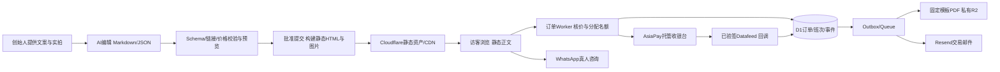

# CQLocalPal（重庆本地通）官网 PRD v0.2 · Codex 独立评议版

- 日期：2026-11-03；作者：Codex；目标上线：2026-11-17；时区：Asia/Shanghai（UTC+08:00）。
- 读者：创始人、运营负责人、设计师、负责实现与验收的 AI。
- 状态：可用于开发的决策稿；支付商户、履约人员与真实素材属于上线前配置门槛，不以虚构资料补齐。
- 版本关系：独立替代 v0.1，不要求开发者再拼接 Kimi 两版才能理解需求。本次交付 PRD 与实验设计，**没有实际执行框架赛马，没有开发或发布官网**。
- 标记：`[事实]` 表示可定位的观察或来源记载，不自动代表来源推论正确；`[假设]` 是本版采用的业务默认；`[判断]` 是明确产品/技术决策；`[待核实]` 是不能冒充已具备的外部条件。以下功能要求与验收线均为 `[判断]`，不是既有系统能力。

**首选路线：[判断] Astro 静态生成 + TypeScript + 原生 scoped CSS/设计变量 + Markdown/JSON 内容集合 + Cloudflare Workers Static Assets/CDN + 小型订单集成 Worker（D1、R2、Queues）+ AsiaPay/PayDollar 托管订金收银台 + Resend 交易邮件 + Plausible Cloud。**

框架结论与 Kimi 相同，但我不接受其因果论证，也不照搬整套方案：支付主选改为适配境内经营主体的 AsiaPay；不用 MDX、自托管统计、双重分析脚本与首屏视频；不把“两个付款链接”当作库存与订单系统。备用框架为 Next.js 静态导出，赛马可推翻首选。首选支付仍须商户审核，不能凭竞品页面宣称我方已能收款。

## 0. 阅读范围、证据索引与冲突处理

### 0.1 已读与未读声明

[事实] 按任务顺序读取：25 → global 目录全部 11 个 `extract.json` 与抓取程序 → 17 → 18 → PRD v0.1/Kimi v0.2 → 24 → 14/19/20/21 与 Anjia/GYG 数据 → Lawson 原文/HN/实验库关键资料 → 23/产品体验方案。读取本地仓库基线 `289e55297e884192a8aa6508fe2bd5e13007e7ba`；通过 GitHub 连接器核对仓库与远端 25 号正文。

| 来源代号 | 完整路径/链接与阅读范围 |
|---|---|
| R25 | [25 总报告](../research/25-竞品全量逆向总报告-14站技术栈与业务模式-2026-11-03.md)，全文 |
| RAW | [global-re 数据目录](../research/data/global-re-2026-11-03/)，全部 11 站 extract.json；[crawl.py](../research/data/global-re-2026-11-03/crawl.py) 全文；HTML 做字符/字节/脚本标签统计，未逐行审计全部压缩代码 |
| R17/R18 | [17 设计与路线](../research/17-官网设计调研与技术路线-2026-11-03.md)、[18 全球同行](../research/18-全球同行调研报告-入境游私人服务赛道-2026-11-03.md)，含 Lawson 六条结论，全文 |
| K1/K2 | [PRD v0.1](2026-11-03-官网PRD-v0.1.md)、[Kimi v0.2](2026-11-03-官网PRD-v0.2-Kimi.md)，全文 |
| R24 | [24 语种与成功经验](../research/24-语种策略与全球竞品成功经验-2026-11-03.md)，全文 |
| R14/R19/R20/R21 | [Jay](../research/14-jaychongqingtour-网站逆向拆解-2026-11-03.md)、[Anjia](../research/19-Anjia-网站逆向拆解-2026-11-03.md)、[240](../research/20-240hoursinchina-网站逆向拆解-2026-11-03.md)、[GYG/Viator](../research/21-GYG-Viator-平台侧逆向分析-2026-11-03.md)，全文 |
| A17 | [Anjia 深抓目录](../research/data/anjiatravel-deep-2026-11-03/)，全部 17 条提取记录、17 页可见正文和脚本引用清单；未下载执行其外链 JS；用户路径中的 `anjiaatravel` 按实际 `anjiatravel` 纠正 |
| G24 | [GYG 24 SKU 清单](../research/data/gyg-chongqing-skus-2026-11-03/gyg-chongqing-skus.md)，全文；错误 HTML 不作为完整产品数据 |
| L | [Lawson 原文](https://nolanlawson.com/2026/10/28/the-ai-cost-of-javascript-frameworks/)，正文、结果表、限制与版本附录均读；删除用户链接末尾误附的 `◦` |
| HN | [HN 50323088](https://news.ycombinator.com/item?id=50323088)，抓取当时页面可见评论全文，约 13.3 万字符；不声称读取已删除或未返回的评论 |
| B | 从 [作者 GitHub](https://github.com/nolanlawson) 定位 [实验仓库](https://github.com/nolanlawson/agent-framework-benchmark)，全文读 README、`template/SPEC.md`、`bench/tokens.mjs`；**未通读整个代码库、测试实现、结果仓库全部逐次轨迹，未复现实验** |
| R23/EXP | [23 业务模式](../research/23-全球竞品业务模式深度分析-2026-11-03.md)、[产品体验方案](2026-11-03-产品体验方案.md)，全文 |

[判断] 来源优先级：本次用户硬约束 > 可核验原始页面/代码 > 报告转述 > 本版假设。竞品公开承诺只证明它公开这么说，不能证明成交、利润、实际服务质量或法律合规。

### 0.2 本次纠错，开发 AI 不得继续传播

1. [事实] `crawl.py` 先 `decode(... )[:900000]`，再 `len(t)//1024`。因此 **878 是截断字符长度换算出的 Ki 单位近似数，不是完整 HTML 网络传输 KB**。TBL、240、Context 存档恰为 900,000 字符。不能用它们算精确倍数、JS 网络负载或 LCP。
2. [事实] RAW 中 240 首页列出 **12 个 hreflang 标签**，含 `en-us` 和 `zh-cn`；“11 语种”可能是不含中文的口径，不能作为无说明的总数。Civitatis 8 个标签含西语/葡语地区变体，不等于 8 种语言。
3. [事实] R14 的 Jay 是 Airo、React/React Router、Express 指纹；R25 的“WordPress 痕迹”与该深度材料冲突，采用 R14 的具体证据。出现框架字符串也只是指纹，不能完整证明服务端实现。
4. [事实] K2 将“月 20–30 单”归于 Anjia；该数实际来自 R14 对 **Jay 的评价反推**，也不是核验过的订单数。全部删除成交量佐证。
5. [事实] A17 存有丰富 family、food、pricing、airport 等正文及 17 页；R19 记录约 40 页内容层。K2 称 Anjia 用轻量牺牲内容/SEO，证据恰好相反。
6. [事实] A17 的 `payment-and-cancellation.html` 写明 **AsiaPay、20% 订金、公司账户、境内尾款**；不是“只用 WhatsApp 人工收款码”。不继承它的 30 天取消梯度，我方按用户硬约束更宽松。
7. [判断] 404、SSL 错误、24 条 SKU 抽样都不能证明“全中国没有供给”或“无人做首晚”；首晚是值得测试的定位，不是已证实的无人区。

## 1. 产品定位、北极星指标与成功标准

**定位：[判断] 面向第一次到重庆的独立旅行者，以一位具名本地接待者解决落地第一晚的不确定性。官网把清楚的服务范围、真实的人、可追责承诺和轻订金交易连接起来。**

英文定位：`Your first night in Chongqing, with someone local by your side.`

主转化只有两类：① 支付 ¥100 或 USD 15 的单笔订单订金；② WhatsApp 真人询单。产品页主 CTA 指向可售日期与订金，无法直接售卖的定制产品主 CTA 指向询单。每屏最多一个实心主按钮，WhatsApp 为明确可见的次按钮。

| 指标 | 定义与口径 | 成功标准 |
|---|---|---|
| 北极星：询单/预订意向转化 | 28 天内发生 `lead_intent` 的去重访问次数 / 同期合格访问次数；意向=WhatsApp 出站点击或有效预订/询价表单提交，单次访问取并集 | ≥3%；累计 ≥1,000 合格访问再作首轮判断；小样本展示分子分母，不伪装统计确定性 |
| 真实询单质量 | 运营收到且包含旅行需求的 WhatsApp/表单线索；排垃圾、重复咨询 | 独立于点击报表，每周与意向量对账；不把点击说成收到消息 |
| 付费结果 | 按有效支付回调确认的唯一订金订单数 | 首个 30 天 ≥10 单为验证目标 `[假设]`；单列退款率和净履约单 |
| 付款体验 | 从日期选择到已支付回执，中位完成时间 | ≤4 分钟；无法保证的银行验证等待另列 |
| 交付信任 | 已确认订单 PDF/邮件、客服真人首响 | PDF 95% ≤5 分钟；值守时段首响 95% ≤30 分钟 |
| 内容与性能 | 全站验收见第 9/13 章 | 移动 Lighthouse 四项 ≥90，4G LCP ≤2.5s；11.24 发布 10 篇人工核验攻略 |
| 评价资产 | 真实履约订单产生的公开评价 | 90 天 ≥15 条、1 年 ≥200 条为运营目标；禁止为达目标造评/有偿换评 |

[判断] 合格访问排除监控、内部测试和已识别机器人，不排除正常跳出；跨设备不强行识别。隐私/拦截导致的分析缺失公开说明；支付台账是交易真值。增长目标不构成上线阻断，付款可靠性构成阻断。

## 2. 目标用户、场景与产品边界

### 2.1 数据支持的人群，不编造人口属性

| 场景画像 | 可用证据 | 需求/页面决策 |
|---|---|---|
| 第一次来重庆、使用英语自助规划的旅客 | [事实] R14 113 条公开评价中国籍字段美国17、澳洲7、英国6，Other53；这是 Jay 评价样本，不是重庆总体 | 先做英文；首页直说落地陪伴；首晚页以集合、通信、付款、入住为顺序 |
| 马来西亚/新加坡等东南亚旅客 | [事实] R24 汇总边检前五为马、新、泰、越、韩，携程春节订单前三为美、马、新；原始统计链接未逐项补齐 `[待核实]` | 预留 `/ms`，通过“偏好语种”字段收集真实需求，不按国籍替用户选语言 |
| 带儿童或长辈、担心楼梯与吃辣的家庭 | [事实] A17 有 family/senior/non-spicy 相关内容和具体服务安排；不等于已测得该类需求比例 | family 单独落地页；儿童年龄段、休息频率、台阶/车辆/儿童座椅条件明确 |
| 追求深入理解城市的私人客 | [事实] R23 Context 专家叙事；RAW 有多日千美元价格字符串，但不证明平均客单 | 私享页突出真实专长、可执行范围与透明报价，不虚构“学者”身份 |
| 已在重庆、临时怕辣或需要协助的用户 | [事实] G24 有 $36 的门票/PDF/Concierge SKU，不能据此断言销量 | non-spicy 内容与产品区分；移动端 WhatsApp 快捷入口、离线指引 PDF |

[事实] 重庆政府公开资料支持 2025 年入境游客 214.78 万人次、同比 +68.2%：[政府办公厅文件](https://www.cq.gov.cn/zwgk/zfxxgkml/szfwj/qtgw/202605/W020260507608428335497.pdf)。这是总人次，不是可直接转化的外国自由行人数。其余年龄、收入、付费意愿不写成调研结果。

### 2.2 本版默认可开发的产品合同

以下是 `[假设]`，用于报价/模板/测试，运营须在 11.06 前核算并填写 `approvedForSale`；未批准的产品展示真实筹备状态、只接询单，禁止用演示价格收款。

| SKU | 定价单位 | 默认范围 | 明确排除/限制 |
|---|---|---|---|
| `first-night` | ¥399/人；订金每订单 ¥100/USD15，不按人重复收 | 英语4–6人小团；机场集合→落地通信/支付指导→指定区域入住协助→夜景/晚餐点单；安排约4小时；含约定共享接机车辆与本地接待 | 餐费、SIM套餐、门票、酒店、签证和保险不含；不得写“首晚全包”。首批按已核实航班窗口开班；入住区域限渝中半岛，超范围仅询单 |
| `concierge` | ¥199/订单，同行1–4人 | 从约定开始时间起24小时，08:00–24:00真人远程问答；一次行前清单、通信/支付设置指导和交通建议 | 不含到场/接机车辆/陪游/门票；不代持账户密码，不保证银行一定绑卡成功 |
| `private` | ¥1,600/团·8小时，1–4人；超范围书面报价 | 私人英语向导+司机+车型确认后的车辆，市区路线与酒店接送 | 景区票、餐饮、酒店、跨市/武隆不含；不可一边写“起价”一边隐藏必付费用；特殊请求先报价再收订金 |
| `first-night-family` | ¥399/人，6岁及以上同价，儿童占座 | 同一英雄服务的家庭节奏班：短步行、每45分钟休息、独立温和餐食方案 | ≤5岁、儿童座椅或特殊无障碍需求先询单并确认，不能直接付订金；不承诺完全无台阶 |
| `food-non-spicy` | ¥259/人，2小时，2–6人 | 市区集合，英语点单与食物文化讲解，4份约定品尝+1饮品包含；明确轻食份量 | 无接机；无清真/无过敏原保证；严重过敏先联系，无法保障则拒售并解释 |
| 加购意向 | 旅拍¥299/30分钟；续程支持¥99/次 `[假设]` | 旅拍10张调色照片、72小时交付；续程一次30分钟远程交通规划 | v1 只收加购意向，人工确认可交付后独立报价；不自动加进订金、不默认勾选 |

[判断] 接机与“按时首晚”相互制约。每个出发班次必须存 `arrivalWindow`、集合最晚时间、车辆座位/行李限制、集合照片。运营只发布已安排人员车辆的班次；已确认班次即使不足4人也不临时涨价，由我方承担履约或取得旅客同意改期/全退。晚点无法赶上时提供免费改期/退款/另报私享，不强制加价。

[判断] 30分钟满意保证从各项服务的实际开始时间计；Concierge 从首次实质服务开始计。服务开始前随时取消全退，包括订金；开始后前30分钟提出不满意，全退本订单服务价，未支付尾款免收。零购物违约全退不受30分钟限制。自选餐厅直接消费不冒称我方已收服务费，详见第10章。

## 3. 信息架构与四语种发布规则

```text
/ -> 302 /en/（不按 IP 强制跳语言）
/en/
  tours/                         三产品比较/全部体验
    first-night-chongqing        英雄页
    first-night-family           家庭细分页，11.17必须上线
    concierge                    远程产品
    private                      私享产品
  add-ons/
    non-spicy-food-tour           可独立预订的细分美食产品
  hosts/                         人格化目录，v1必做
    {host-slug}                  具名主页与个人评价
  guide/
    {article-slug}               10篇，见第8章
  reviews/                       全量、筛选、分页
    write/                       邮件令牌核验提交，noindex
  about/
  faq/
  legal/
    terms/
    privacy/
    cookies/
    refunds/
    no-shopping/
    reviews-policy/
  booking/                       日期、人数、信息、订单核对
    return/                      支付返回/查询，noindex
    manage/                      安全链接管理、取消与PDF，noindex
  contact/                       WhatsApp不可达时的表单/邮箱
  404                            返回真实404
/ms/ /ko/ /ja/                   同构路由定义、文案字典、开发测试样例
/api/* /ops/*                    非营销路由；ops需运营登录，均不可索引
```

[判断] 顶栏：Tours / Meet your host / Guide / Reviews / About，右侧 `Book your first night`；FAQ/联系放页脚和预订邻近。手机菜单保留相同顺序。首页及产品页底部双 CTA；预订页只保留继续/求助；法务、评价提交页不放压迫式悬浮预订条。

[判断] `supportedLocales=['en','ms','ko','ja']`，初始 `publishedLocales=['en']`。未启用路径在生产返回404，无导航入口、无 sitemap/hreflang；预览环境测试四套路径。真正启用后按有等价内容的页面生成互相指向的 hreflang，自引用 canonical；`x-default` 指向该页英语版。绝不把英文复制到 `/ms` 冒充翻译。

[判断] `/ms` 只表示马来语；印尼语是 `id`，不能“一套本地化两国”当成已完成印尼语服务。日本、韩国客群高客单假说不作为开放依据。

语种解锁的三道机械门槛：① 连续28天有效询单 ≥30 条，其中用户主动选择该语种占比 ≥15%；② 全部在售产品、预订错误提示、邮件/PDF、退改与隐私文本经该语种顾问签署校对记录；③ 值守排班覆盖08:00–24:00，并通过10种模拟售前/退款对话，95%真人首响≤30分钟。三项记录进 `locales.json`；缺一项不得发布。翻译过期的价格/条款导致该 SKU 停售该语种，而非静默回退英文。

## 4. 技术路线与架构

### 4.1 四组竞争证据的正面回答

| 问题 | 事实边界 | 对 CQLocalPal 的确定决策 |
|---|---|---|
| Next首页540–878KB，传统派193–283KB，为什么“轻量派经营更成功”？ | [事实] RAW 能支持样本页面 HTML 字符量差异，但878存在截断；没有营收、利润、CAC、转化率或控制变量。TBL本身也是头部；Context/Rails同样大。**“轻量派更成功”尚未成立。** | [判断] 不能用经营标签证明框架因果。只借鉴先输出可读HTML、少发送脚本的策略，以本站同页实验和真实转化验证 |
| Civitatis 用PHP做成西语第一说明什么？ | [事实] 重庆页有 `.php` 指纹，首页未探测到PHP；“西语第一”是R25/R23定位转述，没有本次市场份额证据 | [判断] 即使接受其领先地位，也只说明旧技术不妨碍服务/母语深耕。PHP完全能做结构化数据、图像管线；我方不选自建PHP站是为减少服务器维护和第二语言，不是PHP不能SEO |
| Context 用Rails保持最高客单，框架新旧与品牌溢价有关吗？ | [事实] 有Rails指纹、多日千美元报价；多日总价不能和半日人均价比较，更不能叫核验平均客单最高 | [判断] 无因果证据。高端页应投资可核验专家履历、具体知识、摄影与服务保障。Rails/Next/Astro都能表达高端审美 |
| 240用Next承载11语种，四语种是否足以选Next？ | [事实] 存档为12个标签；多语言可由URL、静态文案与构建完成，没有必须跨页客户端状态的证据 | [判断] 多语种不是选Next充分条件。只选语言基础设施而不引入账户/应用运行时；将来有真实登录、多城市库存后台需求时再评估独立应用 |

### 4.2 原始技术观察：能证明什么，不能证明什么

[事实] 本次对仓库 HTML 重新计数（UTF-8 字节；外链数量是标签数，内联含 JSON-LD/数据，不等同执行代码；**未测完整网络请求、gzip、JS执行或竞争站 Lighthouse**）：

| 存档 | HTML字节 | 外链script标签 | 内联script字节 | 有效启示 |
|---|---:|---:|---:|---|
| 240 首页 | 905,948，已截断 | 14 | 668,233 | HTML 内嵌状态/数据值得预算；不能全算成客户端执行JS |
| Withlocals 首页 | 552,456 | 40 | 245,453 | 依赖数量与首访负担需实测；框架不独自决定 |
| China Highlights 首页 | 198,097 | 2 | 10,010 | 内容型页面可用少量脚本实现 |
| Civitatis 重庆 | 290,390 | 26 | 87,949 | HTML较小仍可能加载大量外链JS；“轻HTML=轻JS”错误 |
| Anjia family | 28,191 | 7 | 5,316 | 细分内容、FAQ、结构化信息并不需要大前端运行时 |
| Anjia airport guide | 55,638 | 7 | 6,666 | 丰富长文与轻HTML可以共存 |

[事实] Anjia 引用 `js/main.js?v=...`、`i18n-dict.js`、页面级词典和Cookie控制的统计；没有由此证明采用哪种 SSG。Jay 的 R14 记录前端包1.16MB但未说明压缩口径。240 有 `/_next/` 与 Vercel响应头。**没有竞争样本使用 Astro 的直接证据，不能说竞品“实测证明 Astro 最优”。**

### 4.3 Lawson 与 HN 的正确用法

[事实] Lawson 单模型、内容型应用实验中，Astro/Next生成成本中位数分别 $2.76/$3.14；Next不是最贵。Astro/Next客户端JS为0/142KiB，性能分100/99；原文明确样本与波动限制。[原文](https://nolanlawson.com/2026/10/28/the-ai-cost-of-javascript-frameworks/)

[事实] [实验 SPEC](https://github.com/nolanlawson/agent-framework-benchmark/blob/master/template/SPEC.md) 禁止构建时取数据及预生成数据页；要求运行时读取API。因此它不是“Astro SSG 对 Next SSG”的实验，也没有测试支付、退款、品牌字体、营销追踪或长期维护。[README](https://github.com/nolanlawson/agent-framework-benchmark/blob/master/README.md) 说明使用隔离容器、独立测试、重复测量；[token脚本](https://github.com/nolanlawson/agent-framework-benchmark/blob/master/bench/tokens.mjs) 区分输入、输出、缓存读/写。合计 token 不能直接乘一个统一单价。

[判断] R18六条结论的裁定：① API稳定性有价值，但训练熟悉度只是解释假说；② 静态优先适合我们，原实验没有直接测试静态生成；③ 单次成本差异存在，不可推算每次维护必然节省相同比例；④ 混合框架边界可能增加错误，本站先用一种交互方式；⑤ 官方工具不保证自动被使用，验收必须独立；⑥ 同规格赛马值得采用，必须加“修改任务”测维护成本。

[事实] HN中既有 Astro混合边界难用的经验，也有相反经验，以及对“小应用代表性”“代码行数代表维护性”的质疑；这是使用者意见，不是可重复测量。[讨论原页](https://news.ycombinator.com/item?id=50323088)

### 4.4 对 Kimi v0.2 的明确同行评议

**裁定：[判断] 接受 Astro 静态优先与托管收银台的总方向；拒绝 K2 当前的证据链与支付落地完整性。我的方案更好之处是降低无代码创始人的运营故障成本，并给出可执行的交易一致性约束，不声称尚未测量的性能胜出。**

| K2主张（含明确沿用K1的部分） | 评议及修正 |
|---|---|
| “Next唯一能11语种+复杂交互” | 错；Nuxt、Rails、PHP等都能做。按当前页面任务选择，不按不可证唯一性选择 |
| “Lawson证明Next最贵” | 与原始结果表直接冲突；删除 |
| “轻量=长寿/经营胜” | 把幸存样本与因果混为一谈；删除 |
| “30KB撑不起内容与审美” | 与A17反证冲突；布局、图片、长文没有最低框架体积要求 |
| “Astro唯一兼顾轻与现代内容” | 错；Eleventy也是认真备选。Astro的具体优势是本项目组件/类型/图片管线整合，属待实验检验的判断 |
| “WordPress/建站SaaS审美天花板低” | 无依据；定制设计可优秀。弃选原因改为插件运维、支付/版本回滚控制成本，不贬低设计能力 |
| “Markdown可自助更新” | 缺编辑与预览操作。补浏览器GitHub表单模板、AI改稿、预览链接、批准发布与回退 |
| “Umami自托管+CF统计” | 为不会维护服务器的创始人增加升级/数据库责任和双口径；改单一Plausible托管 |
| “Stripe Payment Links/Checkout即可” | 缺主体可开户证明、库存绑定、回调验签、幂等、失败/退款/PDF链路；本版全部补齐 |
| “Astro体积必须Next的1/3” | 相对门槛可误选：两者都达线但差距不足时不应重写；改为绝对预算+维护成本判胜 |

### 4.5 分层选型决策表

[判断] 下表成本中，明确标“预算”的数字是规划上限/假设，不是供应商报价。框架依赖使用实验当天安装验证的稳定版，并固定精确版本与 lockfile；不使用浮动 `latest` 进入生产。Lawson记录 Astro7.4.2/Next16.4.3仅为复验参照，不能替代实际安装校验。

| 层/确定选项 | 依据；对AI维护的影响 | 性能与SEO | 成本 | 主要风险与缓解；备选 |
|---|---|---|---|---|
| Astro SSG + TypeScript strict | RAW/A17、L及本站内容任务；模板有类型、业务内容外置，禁止全站hydration | 构建输出正文/metadata，浏览器脚本只做局部增强；不等于天然90分 | 框架无许可费；AI费用实测 | API版本漂移→锁版本/官方文档/升级独立PR；备用Next静态导出 |
| Astro scoped CSS + CSS variables；Lucide按需内联SVG | R17审美要求；小组件库原生CSS可读，减少工具链；不是Lawson已证明优于Tailwind | 无样式运行时、无图标字体；CSS预算20KiB gzip | 无许可费，图标/字体保留许可证 | AI发散→颜色/间距只能取tokens、组件收口；备选Tailwind，只有赛马修改成本显著降低才换 |
| Markdown + JSON + Astro Content Collections（不启用MDX） | A17内容路线；[Astro内容集合](https://docs.astro.build/en/guides/content-collections/)；内容不能夹带可执行JS | 构建schema校验、静态目录/分页；自动图片尺寸 | GitHub现有账户，预算$0新增 | 创始人不懂Git→AI改内容、浏览器预览批准；备选托管CMS，待≥3名频繁编辑者再引入 |
| Cloudflare Workers Static Assets + 全球CDN | [官方静态资产](https://developers.cloudflare.com/workers/static-assets/)；静态资产与小API统一部署，减少Pages/SSR适配组合 | 首页无需函数/数据库；API `no-store`；大陆访问必须现场测，不能承诺必快 | Workers付费基础$5/月，其他按量；[官方价表](https://developers.cloudflare.com/workers/platform/pricing/) | 供应商耦合→静态dist可迁移、D1每日导出；备用Cloudflare Pages静态托管+相同Worker API |
| Worker原生Request/Response + D1 + Queues | 订金/库存/评价必须持久化，静态框架无法消除订单状态；每个模块单一职责 | 不影响营销首屏；所有金额在服务端核对 | 小规模数据/队列预算$5–15/月，非报价 | 跨系统一致性→事件幂等、数据库outbox、补偿流程；不用KV当库存真值 |
| AsiaPay/PayDollar托管收银台，境内持牌经营主体申请 | A17付款页；[PayDollar China](https://www.paydollar.com.cn/en/about-us.html)明确服务中国商户；与目标主体更匹配 | 跳转时才加载支付服务，不在首页嵌支付SDK | 开户费/年费/费率/最低费/退款费均待商户报价；经济模型预留每订金¥10处理预算 | 能力、币种、行业准入不是默认获批；11.05拿合同/测试账户。备用Stripe Checkout仅限真实获批主体；都未获批则只询单，不假收款 |
| `pdf-lib`固定模板 + R2私有文件 + Resend交易邮件 | R24即时凭证；无需实时AI生成，订单事实由模板插值保证 | PDF异步生成，营销页无PDF库；图片离线可用 | 邮件/R2预算$0–20/月；不是承诺免费 | 字体/中文地址/PDF换页→固定字体与长文本测试；备用人工用同模板补发，不能把补发算自动SLA达成 |
| Plausible Cloud Business单一分析 + Search Console + CF错误日志 | [数据政策](https://plausible.io/data-policy)；免自托管升级与统计数据库管理 | 延迟加载统计、不得阻塞CTA；Search Console不需要页面运行时SDK | Business预算$20–40/月，含Stats API；按浏览量及结算周期核价，不误买无API套餐 | 事件可能丢失→订单账与CRM独立计数；广告像素v1不装；备用Umami Cloud而非自托管 |
| `astro:assets`构建AVIF/WebP，公共图片随静态发布 | R17/性能预算，统一处理而非多个图片SaaS | 首图高优先、显式尺寸、其余lazy；不懒加载LCP图 | 构建资源成本，原图归档预算$0–5/月 | Git体积增长→原片存独立归档，仓库仅网页规格图；备用R2公共媒体域 |

[判断] 基础设施/邮件/分析总预算 **$30–85/月**，另计域名年费、AI订阅/调用费、支付手续费、人工翻译、内容与摄影；不能用“免费站”掩盖运营成本。月页面浏览1万、订金100单、存储<1GB为此预算假设，超量告警在预算80%触发。

[事实] [Stripe可用地区](https://stripe.com/global)的收单支持列表含香港等，不列中国大陆；页面底部的大陆语言站入口不是开户许可。外国护照也不自动等于合格收款主体。[判断] 不为使用Stripe虚构海外公司，不把第三方个人账户当备用支付。

### 4.6 备选方案比较与切换条件

| 候选 | 最强理由 | 本次不首选的理由 |
|---|---|---|
| **Next.js 静态导出 + React/TS + CSS Modules + 同一支付Worker** | AI训练样本多、React组件生态成熟；静态导出仍可SEO和低运行成本 | 当前没有需要全站React状态的功能；客户端预算余量可能更小。**不是强制SSR，不是默认很慢**。若赛马所有硬线通过、综合分领先≥10分且初建+修改成本比Astro低≥20%，改用Next |
| **Eleventy + Nunjucks + 原生CSS/TS** | 静态输出轻、成熟模板；能做全部内容页、多语言与SEO | 内容schema/类型/图像流程需自行组合，AI维护收益未必胜Astro。作为第三赛马候选；按4.7相同硬线、领先分与成本门槛判胜 |
| Hono+htmx、Rails/PHP服务端站 | 表单与服务端交易自然，成熟技术可长期使用 | 内容访问不需要常驻渲染服务；前后端整个站绑定运行服务，增加当前无代码团队运维范围 |
| 托管WordPress/Framer | 非程序员可视编辑强、可做高端审美 | 预订/评价验证仍需集成；本项目由AI迭代与Git审阅，插件/平台限制及迁移成本需承担；若未来创始人必须逐像素直接编辑，才重开决策 |

### 4.7 两天赛马：验证而非给首选设计一场必胜比赛

[判断] 实验计划≤16小时操作者工作量，分两天；不做真实支付，不真实联系旅客。主赛 Astro/Next，Eleventy为第三候选，三者全部采用相同原生CSS设计变量、内容、图片、字体、托管方式、mock订单API。用同一开发AI的精确模型ID、推理档、CLI版本与可用文档；禁用额外并行代理；每轮独立干净目录与新上下文，不共享上轮代码。

1. **第1天0–2h：固定测试包。** 首页不作为多变量实验，统一制作 `/en/tours/first-night-chongqing`，含首图、价格三币种、日期/人数选择、含/不含、5条FAQ、3条明确标“test fixture”的评价、移动底栏、空库存/支付失败场景；同图像文件、同字重、同完整文案、同SEO/静态正文要求。独立Playwright测试：键盘完成、无JS可读、人数改价、币种不改CNY尾款、缺字段不提交、失败保留非敏感输入、404真实、schema含正确价格。
2. **第1天2–8h：每栈3次独立生成，共9次。** 每次初建上限25分钟；之后用原会话执行同一修改任务上限10分钟：价格¥399改¥429，添加韩语未发布文案夹具、替换取消提示、追加一项字段并保持无障碍。三轮顺序轮换 A/N/E、N/E/A、E/A/N。AI实际耗时、人工修复、失败均计入，不允许无限返工后只报最好的一次。余下时间用于隔离复验和记录。
3. **第2天0–3h：生产构建测量。** `npm ci`、`npm run build`；相同HTTPS压缩静态服务；相同Chrome/Lighthouse版本，移动390×844、CPU4倍降速、约1.6Mbps/150ms RTT的4G配置写入JSON；每次构建冷浏览器缓存测5次，服务缓存统一预热；另测新加坡节点已部署版本。逐栈报告HTML原字节/压缩字节、全产物大小（排除node_modules与源码map）、CSS、首访全部JS传输/解压大小、LCP/CLS/TBT、Lighthouse四项分数。图片纳入网络总量。
4. **第2天3–5h：维护性复验。** 把每次修改后的产物交给独立测试环境，禁止改验收脚本；创始人从浏览器预览核对价格/文字一次，记录能否不读代码完成批准和回滚。产物依赖、客户端组件数量、人工修复次数作为诊断，不把行数当唯一维护分。
5. **第2天5–8h：出报告与锁栈。** 保存规格hash、模型/依赖版本、日志、产物、Lighthouse JSON、截图和 `results.csv`。字段：`stack,run,initial_ms,change_ms,input_tokens,output_tokens,cache_read,cache_write,cost,manual_minutes,tests_pass,html_raw,html_gzip,build_bytes,js_transfer,js_decoded,lh_perf,lh_a11y,lh_bp,lh_seo,lcp,cls,tbt`。费用按工具实际账单；拿不到token则写`unavailable`，不能从字数猜测。

**硬门槛：** 三次构建及修改均通过功能用例；每次5次测量的中位数满足移动四项≥90、LCP≤2.5s、CLS≤0.1、TBT≤200ms、该产品页首访JS≤80KiB gzip。报告最差值，至少4/5次LCP达线。硬门槛失败者不能靠低token获胜。

**判胜：** 合格候选按总拥有成本代理分排序：初建+修改的模型实际费用25%、总完成时间25%、人工修复时间25%、首访JS15%、构建部署耗时10%；每项以最佳候选/该候选归一为0–100分，零值双方同为0时记100。人工修复时间统一用`1+分钟`避免除零。差距<10分视作不显著，保留Astro；若Next/Eleventy分数领先≥10分且初建+修改成本降低≥20%，切换该候选。三者全失败先减首图/第三方代码、修需求实现，**不降低业务与性能硬线**。两天样本只能支持本项目选择，不能宣称框架普遍优胜。

### 4.8 数据流、实现方式与目录



[判断] 内容和交易是两条管线：库存/付款不触发全站构建，营销正文不依赖D1在线；评价审核完成后导出脱敏快照构建，发布延迟目标≤15分钟。个人数据不能进Git或公开静态文件。

| 功能 | 唯一实现方式 |
|---|---|
| 导航/折叠FAQ | 语义HTML与`details`，手机菜单少量TS；无React岛屿 |
| 价格切换 | `products.json`唯一CNY服务价与`prices.json`带日期参考汇率，`Intl.NumberFormat`格式化；计算规则见10章 |
| 产品/攻略/host | Content Collections校验后静态生成；slug稳定ID与翻译键分离 |
| 可售日期 | 浏览器取仅含SKU/班次/余量的API；提交时再次服务端核库存 |
| 询价/订金 | HTML POST优先，可用TS增强错误反馈；不把邮箱等放URL |
| 评价提交 | 订单完成后一次性令牌；服务端核验、限流、公开前仅隐私/垃圾审查 |
| 评价筛选 | 静态分页20条；首屏已渲染，TS增强产品/星级筛选；首期全量少于200条可构建筛选索引 |
| hosts评价 | 同一reviewId绑定hostId与skuId，不复制为多条评分 |
| 图片/视频 | 构建图片，点击后加载视频，不装外站视频/评价iframe |
| 运营入口 | `/ops`使用Cloudflare Access单一管理身份；班次/订单/退款任务/评价四张简表，原生服务端表单；不是游客账户系统 |

```text
web/
  astro.config.mjs
  src/content.config.ts
  src/content/guides/en/*.md
  src/content/hosts/en/*.md
  src/data/products.json         # 唯一SKU/计价/包含项定义
  src/data/prices.json           # 仅参考汇率/来源/时间；不重复存SKU售价
  src/data/reviews.public.json   # 脱敏构建快照
  src/i18n/{en,ms,ko,ja}.json
  src/config/locales.json
  src/layouts/{Base,Product,Article}.astro
  src/components/{Header,Hero,ProductCard,Price,TrustBar,ReviewCard,HostCard,BookingForm,Footer}.astro
  src/styles/{tokens,global}.css
  src/scripts/{menu,currency,booking,analytics}.ts
  src/pages/[lang]/...           # 对照第3章逐一实现
  src/assets/                   # 网页图和授权字体
  public/robots.txt
worker/
  src/index.ts
  src/routes/{booking,payment,manage,reviews,ops}.ts
  src/domain/{pricing,inventory,orders,refunds}.ts
  src/providers/{asiapay,mail,pdf}.ts
  src/jobs/{outbox,reconcile}.ts
  migrations/                   # SQL，有版本/回滚说明
shared/
  schemas/                      # SKU/价格/字段/事件类型
  fixtures/                     # 仅测试；构建禁止生产引用
ops/
  content-editing.md
  payment-reconciliation.md
  refund-runbook.md
  recovery.md
experiments/stack-race/          # 规格、日志、原型与报告，未执行前不存在结果
```

[判断] 前端一套模板，交互只用TS，不混装React/Vue/Svelte。支付、PDF、邮件各一层provider边界，业务订单不带某供应商专属字段到页面。密钥只在Worker secret；公开环境变量只有域名/语种/公开联系方式。CI包括类型/schema、构建、核心交易用例、链接/SEO检查；内容纯改稿不重复跑全支付测试。

## 5. 逐页面详细需求

### 5.1 全站共同合同（FR-01）

每页只有一个H1，顶部跳到正文链接、面包屑（首页除外）、页脚真实经营主体/联系方式/政策链接。导航和正文不用JS也可读；图片必须有用途合适的alt，装饰图alt为空。主CTA保留`page_type/sku_id/placement`标识。展示价格必须同时说明计价单位、总服务价、订金抵扣和排除项。不能用未经核实的评分、客人数、倒计时或“仅剩2位”做氛围装饰。

手机基准390px，320px不横向滚动；正文≥17px，辅助文字≥14px；按钮触控区≥44×44px，主按钮高48px。底栏预留安全区及等高正文padding，键盘打开时不遮输入。表单返回保持非敏感已填值；错误提示不依赖颜色。

### 5.2 首页 `/en/`（FR-02）

**目标：** 10秒理解“谁在当地接住我、要付多少钱、怎样有保障”；第一次CTA曝光即能进入英雄预订。

自上而下固定顺序：

1. 顶栏与语言入口（仅已发布语言）；不展示灰色国旗菜单。
2. 左侧H1与80字以内承诺、右侧真实接待者与旅客画面。英文：`Land in Chongqing. Feel looked after.`；副文案说明英语本地团队、首晚服务、¥399/人及订金。主`Reserve with a ¥100 deposit`，次`Ask a local on WhatsApp`。
3. 首屏至首图下沿可见信任条：`No shopping stops` / `Cancel before we start, for a full refund` / `Not happy in the first 30 minutes? A full refund.` / `A real reply within 30 minutes, 08:00–24:00 Beijing time`。评分有真实数据才加入，不能挤走退款承诺。
4. 一条具名host介绍：真人照片、真实语言能力、为什么熟悉这条路线，链接hosts。
5. 英雄产品大卡及两个较小入口（Concierge、Private），各含价格、时长、适用人群、接送边界、取消摘要。
6. `Your first evening, step by step`：机场/入住/第一餐/夜景四步，区分包含车辆与不含餐费。
7. 最近3条已验证评价（非轮播，默认新到旧）；如3条中没有中评但全量存在1–4星，追加一条最近中评并解释展示规则；无真实评价采用第6章空态。
8. 零购物保证横幅、三个最相关攻略、结尾CTA、法务页脚。

**移动：** 首图不占满整屏，首屏保留价格与CTA；两次自然滚动内看到产品范围和host。**埋点：** `hero_view`、`cta_click`、`product_view`、`host_open`、`review_view`、`guide_open`。

### 5.3 三个产品模板（FR-03/04/05）

三模板共享信息结构，但不拿同一“流水线行程”填满所有产品。

**T1 首晚时间线模板** `/en/tours/first-night-chongqing`：

1. 面包屑、H1 `Your first night in Chongqing, sorted.`、实拍主图、¥399/人+约4小时+英语+班次窗口。
2. 右侧预订摘要（手机移到主图下）：CNY总价、USD/EUR参考价、人数、订金每单¥100/USD15；主`Choose your arrival date`，次WhatsApp。
3. 一句话范围和不含项；不能先收订金再告知餐费。
4. `Before you land`：落地资料、集合照片、接机窗口和航班晚点处理。
5. 时间线采用相对时间：T+0–45min接机与设置协助，T+45–105min交通/入住，T+105–180min点餐与城市介绍，T+180–240min夜景与次日建议。具体班次根据实际交通填写开始时间，示例不能当实时时刻。
6. 集合点模块：两张已踏勘照片、中文可复制地址、地图外链、备用联系方法；地点未提供不允许该班次售卖。
7. 两列包含/不含、体力要求（最长连续步行30分钟、可休息；实际路线复核）、饮食限制、行李限制。
8. 当班host或可选host介绍；未分配时写`Your host will be confirmed before payment`并转询单，不假装某人带队。
9. 退款/满意保证/零购物一体说明；产品关联评价；5问FAQ：晚点、单人是否成团、餐费、支付失败、如何退。
10. 最后一张订单摘要与CTA；相关family/non-spicy链接。

**移动：** 时间线纵向，照片可点击放大，地址可复制；固定底栏`From ¥399/person · Reserve` + WhatsApp。**事件：** `product_view`、`arrival_help_open`、`availability_view`、`booking_start`、`policy_open`、`whatsapp_click`。

**T2 服务清单模板** `/en/tours/concierge`：

1. H1 `A local contact, before and after you land.`，¥199/订单/1–4人/24小时服务窗口。
2. 主`Book your local support`，次`Ask what’s included`。
3. 五个具体能做的任务：行前清单、通信设置指导、支付设置指导、交通解释、入住沟通；每项写结果，不能写“无限制解决一切”。
4. 不能做的三类：不到场、不代购账户、不处理卡号/密码；显性`Remote support. Airport pickup is not included.`。
5. 从核对页约定开始时间起24小时的服务窗口、08:00–24:00值守及离线留言、负责host；行前通用清单免费提供，不提前消耗服务窗口。30分钟满意保证单独从首次实质服务开始计算。
6. 示例行前清单预览、退款保证、关联评价、5问FAQ：是否接机、能否绑卡保证、服务多久、无WhatsApp、何时退款。
7. 首晚升级入口显示两个产品的范围差异，不默认叠加收费；结尾同CTA。

**移动：** 不放假日历旅行团时间线，选择开始日期/时间后确认服务窗口。**事件：** `product_view`、`scope_expand`、`booking_start`、`upgrade_interest`。

**T3 私享报价模板** `/en/tours/private`：

1. H1 `Chongqing, at your pace.`，真实host与城市场景双图；固定标准款¥1,600/团/8小时/1–4人。
2. 包含车辆/司机/英语向导以及餐费门票排除项；更大人数/跨市只展示询价入口。
3. 三种路线方向：街区与城市故事、建筑与摄影、慢节奏文化；每种说明实际服务，不生成伪学术头衔。
4. `Meet the person who will show you around`：真实专长证明和两则相关内容。
5. 一个8小时示例行程、可改/不可改项目、接送区域、车辆及行李边界。
6. 报价表单：日期、人数、兴趣、联系通道，主`Build my private day`；标准款可请求该固定价，无已确认host/车不能先收钱。
7. 承诺/评价/FAQ：按人或按团、包含、超时、变更、退款；报价后安全链接进同一预订流。

**移动：** 报价摘要置顶，表单单列；英文`No payment until your route and total are agreed.`。**事件：** `private_quote_start`、`private_quote_submit`、`host_open`。

### 5.4 细分页面与加购（FR-06）

| 页面 | 目标与从上到下的模块 | 英文方向/CTA | 手机/事件 |
|---|---|---|---|
| `/en/tours/first-night-family` | family H1→同价与年龄政策→家庭实拍（监护人授权）→6–11/12–17年龄段→每45分钟休息/厕所与短步行→车辆座椅核对→非辣饮食→家庭班时间线→含/不含→退款→关联host/评价→FAQ | `An easier first evening for your whole family.`；`Plan our family arrival`；符合自动售卖条件才显示订金按钮 | 只问年龄段不问儿童姓名/生日；小于6岁或座椅未确认阻止支付、直接询单。事件`family_fit_submit`,`booking_start` |
| `/en/add-ons/non-spicy-food-tour` | H1→¥259/人/2小时→菜品实拍与四份品尝清单→不辣与不过敏区别→饮食适配表→市区集合/步行范围→菜单替换规则→食材沟通责任→退改/评价→FAQ | `Chongqing flavour, without the chilli challenge.`；`Book a non-spicy food walk`；重度过敏入口`Check dietary fit first` | 饮食信息分两层，敏感详情提交前单独同意；事件`dietary_fit_check`,`booking_start` |
| `/en/add-ons/` | 已体验后的下一步→美食可订卡→旅拍/续程意向卡→实际价格单位/交付时间→联系方式 | `Make tomorrow easy, too.`；`Ask about availability` | 不自动弹窗、不预勾选、不强迫多件购物车；事件`addon_interest` |

[判断] `guide/non-spicy-food-in-chongqing`讲如何自行吃饭；`add-ons/non-spicy-food-tour`卖实际服务。两页独立意图、自canonical，互链，不能只换标题复制正文。

### 5.5 攻略中心与文章模板（FR-07）

**中心：** H1 `Make yourself at home in Chongqing.`→First arrival/Food/Getting around/Family四分类→三篇起步路线→全部文章卡（标题、摘要、核验日期、作者）→免费生存指南PDF→轻CTA。初期10篇不做站内全文搜索，无结果显示清除分类。

**单篇固定顺序：** H1→50–80词直接答案→作者/当地核验人/更新时间→锚点目录→步骤/价目或比较表→实拍+图注→常见失败与处理→适用限制→官方来源→相关2篇→相关产品软CTA。文案例`Prefer a local to walk you through it?`。阅读页最大70ch，不使用打断阅读的全屏弹层；当屏内有信息卡时CTA固定条不得抢占正文。事件：`article_view`,`toc_click`,`guide_product_click`,`lead_magnet_request`。

PDF磁铁：`Chongqing First-Night Checklist`，3页以内，提供直接预览；邮箱填写仅用于发下载链接，营销订阅单独未勾选。提交成功给页面下载入口并发邮件；失败仍允许直接下载公开版本，不扣住内容。事件`guide_download`不能算旅行询单。

### 5.6 评价页（FR-08）

目标是核验信誉而非营造全五星。顺序：H1 `Every verified experience. Every honest rating.`→本站已验证数量/均分和统计口径→真实第三方来源外链（有才显示）→产品/星级/日期筛选→新到旧分页→公开回应→如何验证及纠错入口→轻CTA。

每条含公开昵称、可选国家、服务月份、sku、host、星级、原文、翻译标签、订单验证方式、激励声明（本版均为无奖励）、我方回应时间。禁止公开订单号、完整出行日、邮箱、证件或联系电话。中差评回应目标1个营业日内；无回应仍按时公开，不等回复后再放行。全量包含所有已核验合法评价，垃圾/个人隐私处理依据公开规则，不以低分为理由删除。

无真实评价：`We’re welcoming our first guests. Verified reviews will appear here after completed trips.`，显示核验流程与真实团队，零条不显示均分，禁止安排假4星“显得真实”。筛选空态`No reviews match these filters.`并提供清除。手机筛选换行，评价全文展开可访问且无横滑。事件`review_filter`,`review_expand`,`review_source_open`。

### 5.7 `/en/hosts/`、host主页与 `/en/about/`（FR-09/10）

**hosts目录：** `Meet the people behind your first night.`→团队真实合照/单人卡→语言与专长可见→服务班次说明→安全与培训流程→FAQ/CTA。host卡不显示伪造“Superhost”。至少一个真实具名host、本人授权照片和已核验英语能力才可上线售卖。

**host详情：** 名字与自然肖像→本人80–120词城市故事→语言/实际经验→喜欢带客人去的3类地点→所带产品→其真实订单评价→排班/非保证说明→`Plan a night with our team`。如请求指定host需核验库存；替换host在付款前提示，付款后更换必须通知并允许免费取消。手机传达名字与语言优先，不加载自动播放视频。事件`host_view`,`host_product_click`,`host_request`。

**About：** H1 `Local knowledge. A name you can reach.`→创始人与本地合伙人真实经历→为何做首晚→真实团队工作方式→三条承诺→经营主体/合作持牌社关系及证照核验链接→真实地址/联系→可点击60秒故事视频→CTA。外国创始人身份有记录/本人同意才写，不展示护照影像；不使用“外国人更可信”的无依据优越叙事。手机只载视频封面。事件`about_view`,`credentials_open`,`video_play`,`whatsapp_click`。

### 5.8 FAQ、Contact、法务（FR-11）

- **FAQ：** 预订/行前/付款/接机/饮食/取消六组；问题可锚点直达；默认展开最常见“订金怎么算”。答案从结构化政策数据共用，不能与产品页另抄一份冲突。底部`Still unsure? Ask a real local.`。手机原生details；事件`faq_open`,`contact_open`。
- **Contact：** WhatsApp深链→值守时间→邮件和表单→业务地址→无网备用指引。WhatsApp不可达不循环打开；提供可复制号码、邮件及表单。默认预填消息仅产品、日期、人数、短来源码，禁止隐含把过敏或联系人信息塞进URL。事件`contact_submit`,`contact_channel_copy`。
- **Legal hub：** 六个独立政策链接、经营主体与生效日期、可打印HTML。条款页顺序固定“适用范围→关键摘要→完整规则→联系方式→版本”；Refunds页带订单管理入口；No-shopping页解释违约取证方式但不要求顾客举证到无法退款；Reviews policy页公开审核标准。无营销悬浮条；事件仅`policy_open`，不采集阅读中的个人信息。
- **404：** `We couldn’t find that page.`→返回首页/全部体验/联系；请求返回404，不能用首页软404。

### 5.9 预订与售后页面（FR-12）

| 页面/步骤 | 模块与文案 | 移动与状态 | 埋点 |
|---|---|---|---|
| 日期与人数 | 产品摘要→班次日期/到达窗口→人数/儿童年龄段→可售判断；`Choose your date, then meet your local.` | 北京时间明确；当地日期不自动推算；满员可查另一日/询单 | `booking_start`,`slot_select` |
| 联系资料 | 称呼、邮箱、WhatsApp可选；接机产品另需航班、酒店区域和行李；敏感需求另入口 | 姓名不强制护照名；邮箱确认；自动填充；错误聚焦首项 | `booking_details_valid` |
| 核对 | 服务总价、订金实际币种、尾款CNY、退款摘要、经营/收款主体、条款版本；`Pay USD 15 now. Your remaining balance is shown below.` | 主按钮金额与收银台一致；不能有不可见附加费 | `checkout_started`（服务端生成付款凭据后） |
| 付款返回 | 查询中→已收到款且已确认/收到款待人工处理/失败/取消 | 不靠URL参数判成功；查询中最多轮询60秒后提示稍后查邮件，禁止让用户再次支付 | `payment_return_view`；订单成功只由服务端记 |
| 管理页 | 邮件安全链接→订单范围/日期/host/钱款→PDF→免费取消/退款状态→联系 | 链接过期可重发；避免显示完整证件；取消二次确认且显示退款金额 | `booking_manage_view`,`cancel_requested`,`voucher_download` |

## 6. 组件库规格与数据契约

### 6.1 组件状态

| 组件 | 必需字段/外观与交互 | 状态与空态 |
|---|---|---|
| Button/Link | primary深墨绿填充、secondary描边、text带下划线；动作用button、导航用a；图标与文字共同可读 | default/hover/focus-visible/pressed/loading/disabled；loading文案`Saving your details…`，禁重复提交；disabled邻近解释原因 |
| ProductCard | 图片、标题、价格单位、时长、含什么、取消摘要、接送类型、CTA；整卡主链接与独立按钮不嵌套 | available/sold-out/inquiry-only/not-approved；无图用品牌纹理并显性说明筹备，无库存不放假余量 |
| Price | CNY正式价；USD/EUR参考价及`Approx.`、更新日期；per person/per group、人数合计、订金与尾款 | 正常/报价中/汇率过期；超过35天参考价隐藏并显示CNY，不影响CNY合同；价格过期支付端返回重新核对 |
| ReviewCard | reviewId、公开昵称、星级可读文本、月份、host、SKU、验证、回应与来源 | 无回应/有回应/翻译可展开原文/隐私已脱敏；空集合不能放演示评价 |
| TrustBar | 最多3–4条短承诺+政策链接，图标不替代文字 | 客服在线/非值守；离线显示`Back at 08:00 Beijing time`；评价量为0隐藏数字，不隐藏制度承诺 |
| HostCard | 姓名、照片授权、语言、专长、介绍、可订状态 | active/unavailable；无真人资料不生成AI人像替代 |
| FormField | 永久label、help、autocomplete、类型、最大长度、错误文本aria-describedby | pristine/editing/invalid/submitting/success/error；提交失败保留字段，不存支付或健康数据到localStorage |
| BookingSummary | SKU/价格版本、班次、人数、包含项、CNY总价、实收币种订金、抵扣额、CNY尾款 | stale/sold-out/processing/confirmed；变价必须用户重新确认 |
| Notice/Empty | 一个标题、一句解释、一个恢复动作 | 离线`You appear to be offline. Your payment status has not changed.`；网络失败不伪装未支付 |

### 6.2 数据契约（不让AI自行猜字段）

| 实体 | 最低字段与约束 |
|---|---|
| Product | `id,slug,template,priceCnyMinor,priceUnit,priceVersion,capacityUnit,durationMinutes,agePolicy,pickupType,inclusions[],exclusions[],dietaryLimits[],hostIds[],approvedForSale,policyVersion`；金额为整数分；严禁前端传价决定实收 |
| LocalizedContent | `entityId,locale,title,summary,body,seoTitle,seoDescription,reviewer,reviewedAt,published`；locale受枚举限制，缺必需文案构建失败 |
| Departure | `id,skuId,startAtUtc,timeZone,arrivalWindow,capacity,hostId,vehicleStatus,meetingPointId,status`；展示用Asia/Shanghai；只允许approved/open班次被购买 |
| Order | `id,skuId,departureId,partySize,contactEncrypted,priceSnapshot,policySnapshot,provider,providerRef,paymentStatus,fulfillmentStatus,depositAmountMinor,depositCurrency,creditCnyMinor,balanceCnyMinor,createdAt,version`；价格/政策快照不可被后续改稿覆盖 |
| PaymentEvent | `provider,providerEventKey,payloadDigest,verifiedAt,orderId,amountMinor,currency,result`；唯一键去重；不存完整卡数据 |
| OutboxJob | `id,orderId,type,attempt,status,nextAttemptAt`；订单变更与outbox同事务保存，避免收到钱却漏发凭证 |
| Review | `id,orderIdPrivate,skuId,hostId,rating,bodyOriginal,locale,publicName,countryOptional,serviceMonth,verifiedAt,consentAt,incentiveDisclosure,moderationReason,response,responseAt`；订单关系不出公开快照 |
| Inquiry | `id,skuId,preferredLanguage,tripDateApprox,partySize,contact,sourceCode,status,receivedAt,firstHumanReplyAt`；可以没有旅行日期，但必须一种可回复联系方式 |

[判断] 星级整数1–5；评价20–3,000字符；咨询备注≤1,000字符；称呼1–80、邮箱≤254、WhatsApp采用国际区号并允许留空。服务端校验与前端一致；不以“英文名”排斥其他文字。开发数据用明显假名和测试邮箱，生产构建扫描 `fixture/demo/TODO`，任何伪评价/未核实资质使构建失败。

## 7. 信任组件清单与分布，以及13条经验的落地

### 7.1 页面分布

| 信任项 | 首页 | 产品/细分 | hosts/About | 预订/确认 | 评价/法务 |
|---|---|---|---|---|---|
| 真人与实名责任 | 首屏/第二屏 | 实际host | 完整故事与能力 | 当班host和联络方式 | 回应具名 |
| 已验证全量评价 | 最近评价+全量链接 | 当前SKU评价 | 绑定个人评价 | 服务后核验邀请 | 全量筛选/审核规则 |
| 三币种与单位 | 卡片参考价 | 正式CNY+参考USD/EUR | 不适用 | 实际扣款/抵扣/尾款 | 退款按原币种说明 |
| 零购物、违约全退 | 信任条 | CTA附近/包含项后 | 品牌承诺 | 条款快照/PDF | 完整执行规则 |
| 随时退+30分钟保证 | 退款摘要 | 价格框/FAQ | 服务标准 | 勾选前可读/管理入口 | 完整条款 |
| 真人30分钟响应 | CTA旁 | 同上 | 值守安排 | 求助入口/PDF | 联系页 |
| 经营主体/资质/保险 | 页脚核验链接 | 运营方说明 | 可核验具体文件与有效期 | 收款人/合同相对方 | 主体一致 |
| 集合与现场确定性 | 首晚四步 | 图片/区域/窗口 | 实际路线经验 | PDF照片/中文地址/备用电话 | FAQ |

[判断] 保险凭证未签发不能显示“已投保”，许可证不属于我方不能写成我方持有；必须写合作经营主体及服务责任。顾客拒绝公开照片/昵称不影响享受服务或退款。不能要求“必须给一条4星”来完成设计。

### 7.2 R24的13条抄作业清单逐项决策

| # | 原经验 | 本版动作/优先级/验收 |
|---|---|---|
| 1 | 客群细分 | P0：family与non-spicy在11.17上线，范围/图片/FAQ不同，非换皮SEO页 |
| 2 | 轻订金+境内尾款 | P0：固定¥100/USD15每单，接托管收银台，明示抵扣和境内公司收款；不把竞品“20%”误读为固定¥100 |
| 3 | 响应承诺 | P0：08:00–24:00 UTC+8，30分钟真人首响；排班与超时告警；非值守给明确下一次回复时刻 |
| 4 | Pickup标签 | P0但纠偏：由SKU字段生成Airport pickup/Hotel pickup/Meet on site/Remote support，**不对远程产品虚假承诺接机** |
| 5 | 门票+Concierge | P2：11.24前只采集武隆需求；供应商出票/退改核验后单独PRD，v1不代收第三方票款 |
| 6 | 母语垂直 | P0建四语种架构，P1按门槛发布；西语列观察名单，不能承诺直接“吃下市场” |
| 7 | host人格化 | 从原P2升P0；至少一位真实host与可售SKU绑定，不等平台规模才做信任 |
| 8 | 专家叙事 | P0私享模板采用真实专长；无资格证据不能自称学者或专家 |
| 9 | 即时电子凭证 | P0已确认收款后自动生成并发送PDF，95%5分钟内；付款待核实只发收款处理中提示 |
| 10 | 多语内容资产 | P0英文10篇、核验日期/作者/来源；六个月密度第一改为可测的有效询单，不用数量堆薄内容 |
| 11 | DMC B2B | P2达到30单真实履约且持牌合作合同明确后评估；v1不做B2B门户/批发价 |
| 12 | 免费徒步小费 | P2暂不售卖/不宣传已推出；法律主体、活动成本与小费规则核验后做单独活动。不能用“免费”暗示强制小费 |
| 13 | 评价壁垒 | P0履约后邀请全部客人，90天15条/一年200条目标；P2平台上架独立决策，禁止平台评价复制冒充自站订单验证 |

## 8. SEO与内容计划

### 8.1 技术SEO（FR-13）

- [判断] 所有营销URL静态输出title、description、H1、canonical、正文、OG图、面包屑。默认末尾斜杠规范，另一形式301；保留旧slug重定向映射。价格/locale参数不制造可索引重复页。
- [判断] sitemap只含200、已发布、可索引canonical页；内容真实修改才更新lastmod。按已发布语种生成互链hreflang，语言切换去等价页；缺对应文章回该语种攻略目录并提示，不能伪造等价关系。
- [判断] 订单、管理、安全令牌、预览、ops、评价提交用`noindex`、访问控制和`no-store`；robots不是保护私有信息的手段。营销页面不得误加noindex。
- [判断] 首页/关于用`Organization`与核实后的`TravelAgency`（LocalBusiness子型）资料；产品用`Service`+实际`Offer`，可补充`TouristTrip`路线；攻略用`Article`、作者/审核日期与`BreadcrumbList`；host用真实`Person`。不为了星级而把服务假装为实体商品。
- [事实] Google对自营组织/本地商家的自利评价限制星级展示；标记不是保证富摘要。[Google评价规范](https://developers.google.com/search/docs/appearance/structured-data/review-snippet)。[判断] v1不对自身TravelAgency输出AggregateRating抢星；页面真实评价照常展示。
- [事实] Google已调整/撤销多类FAQ/HowTo富结果支持；不能沿用K1“加FAQPage/HowTo即可获取展示”的假定。[官方变更说明](https://developers.google.com/search/blog/2023/08/howto-faq-changes)。[判断] v1保留可见FAQ帮助转化，不把FAQ/HowTo富摘要作为验收；上线再查官方当前支持列表。
- [判断] Search Console提交sitemap、抽查URL可索引；“11.24已被Google收录”不可作为开发者能保证的条件。交付标准是可抓取/可索引/无schema严重错误与提交完成。

### 8.2 10篇英文内容日历

每篇800–1,400词为上限指导，不强凑字；至少一张自有实拍、一个可执行清单/表、一个当地核验人；政策/交通/价格必须指向当时官方来源，无法核实时不印数字或保证。AI起草，英语顾问与本地运营双审；发布后高变信息30天复查，收到纠错1个营业日处理。

| 日期 | URL `/en/guide/…` | 英文题目/意图 | 核验重点 | 主转化 |
|---|---|---|---|---|
| 11.17 | first-night-in-chongqing | Your First Night in Chongqing: An Arrival Checklist | 集合、网络、入住实际步骤 | first-night |
| 11.17 | payments-and-money | Paying in Chongqing as a Visitor | 银行/支付平台官方规则；不承诺绑卡成功 | concierge |
| 11.17 | sim-card-and-internet | Getting Connected After You Land | 运营商可购产品/设备兼容；不保证所有App可用 | concierge |
| 11.17 | non-spicy-food-in-chongqing | What to Eat in Chongqing If You Don’t Like Chilli | 菜名实拍、店铺确认、过敏与不辣区分 | non-spicy产品 |
| 11.17 | airport-to-your-hotel | From Chongqing Airport to Your Hotel | 当期航站楼/交通官方时刻、夜间选项 | first-night |
| 11.19 | chongqing-with-kids | Your First Chongqing Evening with Kids | 实地台阶/厕所/休息点/车辆约束 | family |
| 11.20 | three-days-in-chongqing | Three Days in Chongqing, at a Comfortable Pace | 可执行交通时间，非极限打卡 | private |
| 11.21 | where-to-stay-first-visit | Where to Stay for Your First Chongqing Visit | 区域优缺点与酒店入口楼层；不装佣金榜 | first-night |
| 11.23 | hotpot-for-beginners | Your First Chongqing Hotpot: Ordering and Spice | 食材/费用/分锅并非无交叉接触 | non-spicy |
| 11.24 | getting-around-the-3d-city | Getting Around Chongqing’s Hills and Levels | 真实出口照片与步行替代方案 | private/concierge |

[判断] 不在首批硬塞签证保证型攻略；这类内容须专业核验和更快更新。每篇攻略内链一个主产品、两篇相关指南、一个host/核验者页；不做十篇所有关键词互塞。

## 9. 性能预算与体验验收

以下是目标预算，不冒充已测成绩；KiB=1,024字节。gzip是CI统一比较口径，线上Brotli可更小，报告必须写明编码。

| 指标 | 硬线/目标 | 测量方式 |
|---|---|---|
| Lighthouse移动 | Performance/Accessibility/Best Practices/SEO均≥90 | 固定版本，对首页、英雄、family、non-spicy、攻略、评价、booking、host各测5次中位；不能只测空首页 |
| LCP | ≤2.5s@4G；长期真实流量p75≤2.5s | CPU4x、约1.6Mbps/150ms RTT，手机390px冷缓存；新加坡/伦敦/美国西部各测；重庆实机验证可用性 |
| CLS/INP/TBT | CLS≤0.1，目标≤0.05；真实INP p75≤200ms；实验TBT≤200ms | 图片/字体尺寸稳定；INP不是用Lighthouse TBT冒充 |
| 首访JS | 首页/攻略目标≤30KiB gzip；任一营销产品/booking硬上限80KiB | 包括分析与所有第三方；托管收银台另测并报告，不混入自站“零JS”宣传 |
| HTML/CSS | 产品HTML目标≤100KiB原始；CSS≤20KiB gzip | 不内嵌全站文章/评价/多语词典；只加载当前语言 |
| 首屏总传输 | 首页/产品≤500KiB；首图≤180KiB；字体合计≤70KiB | 首图不lazy、明确width/height/srcset、桌面大图不发手机 |
| 请求与媒体 | 首屏≤15请求；第三方运行脚本最多1个统计；无自动播放视频 | 浏览器Network确认，无轮播库、地图iframe、评价widget |
| 表单响应 | 本站API正常p95≤1s（支付商响应单列） | 按海外访问实测；pending超过10s给状态解释，不重复扣费 |
| 无障碍 | 键盘完成全流程、200%放大、正文对比≥4.5:1、reduced-motion | 自动检测+人工浏览器；自动分数高不等于无障碍合规认证 |

[判断] 超预算处理顺序：移除非必要第三方→缩图/裁图→减少字体字重→消除重复数据→优化交互；不先隐藏退款或删掉真实评价来凑分。视频点击后加载，首图无入场延迟；不设滚动劫持、鼠标跟随、视差、全站转场或骨架屏等待正文。

[判断] 内容发布有独立预览；上线后首周每日抽测首页/预订，之后每次组件或第三方变更重测。真实CWV尚无足够流量时显示“暂无足够样本”，不凭实验分假装线上p75。

## 10. 支付、确认单PDF、境内尾款与退款详设

### 10.1 开户与集成边界（FR-14）

[判断] 首选 **AsiaPay/PayDollar Hosted Payment Page**，通过合法经营主体取得商户号、测试环境、签名规则、支付结果通知（Datafeed）、交易查询、退款操作权限和对账文件。官方入口：[中国业务说明](https://www.paydollar.com.cn/en/about-us.html)、[开发资源](https://www.paydollar.com/en/resources.html)。公开旧版[集成指南](https://test2.paydollar.com/pdf/op/enpdintguide.pdf)已有签名和Datafeed，但本次未取得我方商户适用的最新协议；生产端点、签名算法、币种权限、超时关闭能力以签约技术包为准，**不照抄旧版SHA-1配置作为新系统安全设计**。

[判断] **自站不收集卡号、不实现支付处理/银行卡认证/清算/钱包，不造支付后端。** 自站只实现必要的订单、库存、托管支付集成和回调记账。这些工作不可用“静态站”三个字省去；退款执行优先使用供应商管理台，由运营核验后操作，状态再回填核对。订金收银台是第三方，订单履约责任仍属于经营方；托管并不自动免除所有PCI、隐私、合同义务。

[判断] 11.05前按主体资质申请并核验AsiaPay；若未获接入、而真实经营主体已有可用Stripe账户，则启用 **Stripe Checkout Sessions**备用适配器，沿用同一订单状态和验收。没有任何获批通道时继续完成全站测试环境，生产只开放WhatsApp/表单；**11.17“可收真实订单”里程碑标为未通过**，不能冒充完成或转用个人收款码。

生产配置最少项：`SITE_URL`、`OPERATOR_LEGAL_NAME`、`LICENSE_REFERENCE`、`WHATSAPP_NUMBER`、`SUPPORT_EMAIL`、`PAYMENT_PROVIDER`、商户币种/签名密钥/通知端点、Resend域名验证、退款联系人、班次host/集合资料。没有这些数据也可从测试夹具开工；禁止把占位值带到正式站。

### 10.2 三币种标价与两种订金选项

- [判断] **CNY是产品合同基准币种；USD/EUR是页面参考价。** 每份价格数据记录汇率来源URL、取数日期、运营核验人。每月更新、超过35天不展示外币参考数字；未取得可信汇率时只展示CNY与`Reference prices are being updated`，这是预览/故障态，三币种正式上线验收仍需补齐。
- [判断] 付款页可选 **CNY100 或 USD15**，默认英语用户USD15；两者是固定付款选项，不声称等值。必须有商户对应币种权限；EUR仅参考、不扣EUR。
- [判断] CNY订金抵扣100元；USD15按订单核对页锁定的 `cnyPerUsd` 折成人民币抵扣，精确到分，银行转换费用不进入我方抵扣计算。`balanceCnyMinor = totalCnyMinor - creditCnyMinor`。页面同时显示抵扣额和尾款；后续汇率变更不改变已签订单。
- [假设] **仅测试示例**：1USD=7CNY、1名首晚客人总价¥399；付USD15抵扣¥105、境内尾款¥294；选¥100则尾款¥299。此汇率不是2026-11-03行情，不得展示生产。
- [判断] 订金每订单一次，人数变化必须重新核价；大团/私享定制先形成包含所有必付费用的书面总价。出发前加购产生独立明细与同意记录，不擅自划款。
- [判断] 结账页英文示例：`Total: CNY 399. Deposit today: USD 15, credited as CNY 105. Balance in China: CNY 294. Your bank may apply its own conversion charges.` 产品页、收银台与确认PDF必须共享同一价格快照。

### 10.3 从访客到确认的顺序

1. 运营在`/ops`发布未来60天已备好host/车辆/集合信息的班次；人数容量单位分别为“座位”或“私团/远程服务订单”。不在Git里把日历写死为天天有空。
2. 访客选产品、班次、人数；服务端核年龄、范围、提前量（默认距开始≥24小时），不适配直接询单。不能把“待核实饮食需求”当成默认允许支付。
3. 填联系信息并核对订单，勾选服务条款/退款规则；邮箱必填用于凭证，WhatsApp推荐但可不填。护照信息非本产品必要，不收。
4. `POST /api/bookings`从SKU/班次生成价格与政策快照，原子分配名额并生成随机订单ID、一次性付款凭据。客户端价格、币种抵扣、host不能作为权威字段。`Idempotency-Key`相同的重试返回同一订单。
5. Worker生成已签名的托管支付请求（或供应商会话），用户离开本站进入收银台；不预加载支付SDK。敏感持卡信息只由供应商收集。
6. 返回页面只显示`Checking your payment…`并查询本站状态；**成功URL、截图、邮件转发均不是付款真值**。
7. 经验证的Datafeed/服务端查询，核商户、订单号、金额、币种、交易成功状态与防重字段，才写`paid`。与库存匹配且履约信息完整时同一事务写`confirmed`、outbox任务。
8. Queue读取任务生成固定模板PDF、存私有R2、发送交易邮件。每项job可重试且不重复发有效确认；网页无需等邮件成功即可显示确认和下载。
9. 邮件含安全管理链接、PDF下载、合同摘要、联系人、集合照片。WhatsApp需客人主动开聊或有合规消息授权，本版不假设能通过普通深链自动发消息。

[事实] 即便使用Stripe，官方也要求用可靠履约逻辑，不能只依赖浏览器成功跳转；可能重复触发，需避免重复履约。[Stripe履约文档](https://docs.stripe.com/checkout/fulfillment.md?ui=full-page)

### 10.4 状态与防重售规则

使用两个独立状态，禁止一个`paid=true`代表所有事完成：

```text
paymentStatus:
  unpaid -> pending -> paid -> refund_requested -> refunded
  pending -> failed / cancelled
  任意不一致 -> reconciliation_required

fulfillmentStatus:
  draft -> held -> confirmed -> started -> completed
  held -> released（先确认通道不能再成功付款）
  confirmed -> cancelled
  paid但库存/范围不一致 -> manual_resolution（不发已确认凭证）
```

[判断] 库存写入集中D1，不能“先SELECT余量、后无条件INSERT”造成并发重售。使用单条条件插入/更新和数据库事务约束，使`held且未释放的座位数 + confirmed/started的座位数 ≤ capacity`（两个集合互斥，不重复计付费座位）；订单/名额/outbox使用D1的`batch()`事务与SQL条件约束；条件更新影响0行不等于事务报错，后续写入须绑定成功占位记录，检测无占位则返回409且不创建付款请求。外部支付调用在事务外，由幂等步骤衔接。[D1接口](https://developers.cloudflare.com/d1/worker-api/d1-database/)。最后一个名额10个并发请求必须仅有一个成功。

[判断] 支付保留目标30分钟，**不能凭本地倒计时释放仍可付款的名额**。正常超时先通知供应商关闭/过期、查询最终状态，只有已关闭未支付才能释放。如果供应商不提供可验证关闭接口，改“人工核对后释放”的保守模式，页面显示暂不可售；未确认付款窗口和防重保证前不开自动即时预订。延迟成功回调遇名额已释放，只能重新原子检查余量；不足则`manual_resolution`并优先全退，不悄悄挤入超员团。

### 10.5 最小接口合同

这些是**本站**接口，不假装是供应商真实API名字。

| 接口 | 输入/输出/错误 |
|---|---|
| `GET /api/availability?sku=…&month=…` | 只返回已发布班次、北京时间、适配限制、可售状态；不返回旅客/司机隐私；缓存≤30秒，提交重查 |
| `POST /api/bookings` | SKU/班次/人数/联系资料/同意版本/订金币种；返回opaque bookingId和付款下一步；400字段错、409满员/价格变更、422不适配、429限流、503通道不可用 |
| `POST /api/payments/notify` | 接收原始通知体并验签，唯一`provider+eventKey`；验证通过且入库成功才按供应商协议ACK；失败不回假成功 |
| `POST /api/bookings/status` | 安全会话或令牌授权；返回已脱敏状态、金额摘要/可下载标记；不允许仅凭递增订单号查询 |
| `POST /api/bookings/cancel` | 安全令牌+CSRF保护、取消原因可选；返回取消受理及退款任务；重复请求同一结果 |
| `POST /api/manage-link` | 输入邮箱/订单识别信息，统一返回“如匹配会发链接”；避免泄露是否有订单，限流 |
| `POST /api/reviews` | 一次性评价令牌、星级/正文/公开昵称/公开同意；已使用返回409并提供安全修改入口，不创建多条 |
| `POST /api/inquiries` | 联系方式至少一种、产品/人数/大概日期可选、偏好语种；成功返回线索编号和响应承诺 |

### 10.6 异常矩阵

| 触发 | 用户看到/能做什么 | 系统与运营必须做什么 |
|---|---|---|
| 银行拒付/3DS中断 | 清楚失败，尝试其他卡或WhatsApp；原订单可继续 | 未取得成功证据不改paid；一个订单只允许一个活动付款尝试，重试先关闭/核实旧尝试 |
| 用户双击/网络重试 | 保持一个提交状态 | 幂等键复用；不重复占位、不重复收订金 |
| 付款成功、回调迟到 | “正在确认，请勿再次付款”，可查邮件/联系 | 支付查询补偿任务；异常5分钟入运营告警；不得判失败重新收钱 |
| 重复/乱序回调 | 用户状态不倒退 | 唯一交易号；成功后来的failed不覆盖paid；退款按最终查询确认 |
| 付款金额或币种不符 | 人工核验，明确尚未确认 | 不发确认PDF；冻结履约状态、核对退款，不按客户端值入账 |
| 邮件退信/PDF失败 | 页面显示已付款，提供联系人/可用凭证入口 | 支付不回滚；任务1/5/15分钟重试，超限队列+人工；补发同一订单版本 |
| D1/通道故障 | 暂不能预订，可WhatsApp询单 | 新收款关闭；原通知失败让供应商重试；数据库恢复后对账补齐 |
| 客人错过接机窗口 | 免费改期/退款/明确另报价的私享选项 | 不默认加收费用；运营记录顾客选项 |
| 天气/我方人员无法履约 | 免费改期或原路全退 | 主动通知；不以代金券替代客人选择退款 |
| 回调真实重复扣款 | 主订单仍只确认一次 | 第二笔记独立付款异常并全额原路退，主动告知，不能吞重复款 |

### 10.7 确认单PDF（FR-15）

[判断] 固定英文模板2–4页，非实时LLM生成；内容来源只有已确认订单快照与经核验集合材料。四语种模板键预留。包含：品牌/经营与收款主体、随机订单编号、旅客称呼、人数、产品、当地开始时间及UTC+8、实际host、集合照片/中文地址/导航外链、航班窗口、含/不含、总价/已付订金原币种/抵扣额/尾款CNY、退款与30分钟规则、零购物承诺、WhatsApp/电话/邮件、离线备用流程、条款版本与生成时间。

字体嵌入且中文地址可复制，图片压缩；单份≤1MB；无身份证/护照号。PDF存私有R2，下载接口验证管理会话并返回短时下载权限；不能把订单号当密码或公开bucket。邮件管理链接有效7天，可重发；取消后PDF页眉/在线状态标记Cancelled，不生成仍可当有效凭证的新文件。临时下载授权≤15分钟；管理页交换令牌后清理地址栏，`Referrer-Policy: no-referrer`，不加载第三方统计。

### 10.8 境内尾款、取消与退款（FR-16）

- [判断] 到达后、服务开始前核对书面合同和订单明细，尾款以CNY付到经营主体的商户收款码/POS或收据制现金。**只有确认具备外卡受理的POS才展示“Card accepted”**；默认公开现金CNY+企业商户移动支付，不能用个人码承诺外卡一定可用。
- [判断] 运营在管理表记录尾款金额、渠道、凭证号与经办人；出具收据，状态`balance_paid`。不能把现金尾款混入在线支付收入重复统计。Concierge即使先行远程交付，也按已约定到华尾款执行；取消整个赴华行程按未用/满意保证规则结算，不改成隐性全款预付。
- [判断] 服务开始前随时可取消，**全额退已向我方支付的本订单金额**；支付手续费由我方承担，不从本金扣。服务开始后30分钟内不满意，同样全退；自愿选择继续服务超过30分钟后，无理由保证不再自动适用，未履约部分仍按具体纠纷处理。此范围必须紧贴“随时退”文案，不能藏在脚注。
- [判断] 零购物定义：无安排购物店停留、强迫/诱导购物或靠购物返佣替代服务；正常就餐和客人主动要求去普通商店不被伪装成“购物团”。发生违约，全退该订单服务费含订金与已付尾款。未付余额取消。运营不能以“已超过30分钟”拒绝。
- [判断] 取消提交立即留时间戳/停止后续付款；值守时段30分钟内真人受理，1个营业日内发起供应商原路退款，到账时间用商户合同实际范围告知，不编造固定银行到账天数。已原币种收USD15就退USD15；境内尾款原渠道退CNY；不可原路时由本人核验并书面同意替代方式，不能默认返券。
- [判断] `refund_requested`只表示已受理，供应商确认完成/对账核实后才是`refunded`；邮件分别通知受理与完成。退款失败有原因/下次处理时间/负责人，未成功前每天提醒；手续费、银行外汇差异分别说明，我方不把自身手续费转嫁。
- [待核实] 经营主体/旅游合同适用、退费权利与消费者所在地强制规则由专业顾问核对；本段为拟履行的商业承诺，不声称法律允许排除其他法定权利。使用“订金/booking deposit”，不自行将其解释成法定“定金”。

## 11. 数据、埋点、隐私与运营合规

### 11.1 事件字典（FR-17）

| 事件 | 触发条件 | 允许属性/去重 |
|---|---|---|
| `page_view` | 页面实际可见 | path、page_type、locale、归一UTM；禁原始查询串 |
| `cta_click` | 用户激活CTA | sku_id、placement、destination_type；不采按钮附近个人文本 |
| `whatsapp_click` | 用户主动开外链 | sku、来源码；仅代表出站意向，不代表发出消息 |
| `lead_intent` | WhatsApp点击或有效询价/预订资料提交 | 页面/渠道；可多次发送，报表按发生过该事件的visits取并集，不把事件次数当转化访问数 |
| `inquiry_received` | 服务端实际写入有效咨询 | CRM记真实线索；统计只上传不含身份的渠道/语种 |
| `checkout_started` | 成功生成托管付款请求 | sku、支付币种；按order在服务端去重，分析平台不传原始订单ID |
| `deposit_paid` | 已验签成功且金额正确 | 订单账记录；向分析系统只发匿名聚合或合规服务端事件；不依赖return页 |
| `booking_confirmed` | 名额/付款/host全部确认 | 唯一订单一次；和`deposit_paid`分别列出异常差额 |
| `refund_requested/completed` | 受理/真实完成 | 原币种金额、原因枚举；不传自由文本 |
| `review_submitted/published` | 收到/公开 | rating、sku；无姓名/正文/令牌 |

[判断] 固定选Plausible Cloud **Business**，不另建统计数据库。预先配置`lead_intent`目标；Stats API同一28天窗口分别读取全部合格`visits`、发生该目标的`visits`，两者相除计算北极星；不使用默认按visitors计算的`conversion_rate`替代。上线用一访问连续触发两种意向的测试核对分子只增加1。统计请求限已同意访客，分母也限定同一可测样本；无法代表拒绝统计的人群，报表须注明。API密钥只在服务端，财务/履约以D1和收单对账为准。[事实] 官方文档明确`visits`与`visitors`不同，Stats API属于Business套餐：[接口与套餐说明](https://plausible.io/docs/stats-api)。

[判断] `/booking/manage`、评价令牌页、付款返回页不装第三方统计，转化成功由订单端统计。UTM只允许source/medium/campaign的白名单值；任何含邮箱/电话/令牌的URL先清理再入日志。WhatsApp来源码只能辅助人工归因，不能破解私聊或自动读取消息。

### 11.2 运营控制台与无代码维护

- [判断] 创始人日常路径：向AI描述“改哪个产品/哪篇文章”→AI只改内容文件并打开预览→创始人看手机/桌面预览→批准合并发布。不能让创始人手写MDX组件或SQL。
- [判断] `/ops`四个表：班次（开关库存/host/车辆）、订单（状态/尾款/补发）、退款任务（受理/供应商结果）、评价（隐私处理/公开回应）。仅经营负责人和客服负责人访问；不暴露完整支付凭据；敏感操作记审计日志。
- [判断] 每天09:00运营看“已收款未确认、确认未发PDF、退款未完成、未回复线索”；每日把网关结算报告与订单号/金额/币种核对。值守同事接力需写负责人，不让“真人30分钟”只停留在网页。
- [判断] 发布回退一键恢复上一个静态版本；数据库采用向后兼容迁移，不能靠回滚代码删除真实交易。每日加密备份，演练恢复订单/评价；目标RPO≤24h、RTO≤4h，支付商台账补齐备份后的付款。

### 11.3 合规决策（FR-18）

| 事项 | 本版确定要求 | 事实/待核实边界 |
|---|---|---|
| 数据最少化 | 初始订金不收护照号/照片、完整出生日期、卡号；有票务实名要求时另行通知并通过经营方安全渠道收集 | v1不代售需证件票务；不把竞品采集字段照抄 |
| 隐私告知 | 说明经营/数据处理主体、用途、处理商、存储地域、联系方式、删除/访问请求；服务联系与营销同意分开 | 各服务商实际地域/DPA及跨境机制 `[待核实]`，不能写“全球CDN天然合规” |
| Cookie/统计 | v1默认严格方案：必要订单会话可用；非必要分析在明确同意后加载；同等显著“Accept analytics / Reject optional”；可随时改；不阻挡订金或WhatsApp | Plausible无Cookie设计不等于整个站无同意义务；本版保守产品选择，不宣称各地法律统一要求 |
| 表单敏感需求 | 过敏/行动需求单独告知用途，用户可选直接人工说明；只对当班人员可见 | 不把敏感信息放分析事件、Git、公共PDF或WA预填URL |
| 评价邀请 | 所有已完成订单同样邀请，不按满意度筛选；本站核验与第三方来源清楚区分 | 已验证只能说明订单关联，不能暗示第三方独立审核 |
| 评价激励 | **v1零评价激励**。取消EXP“Google/官网截图换¥30”；将来若有不关联评分的私有研究奖励，需另行规则评审，公开受影响关系 | [事实] Google禁止用付款、折扣、赠品换任何评价，也禁止选择性拉好评；披露不能使此做法合规。[官方政策](https://support.google.com/contributionpolicy/answer/7400114?hl=en) |
| 退款与零购物 | 支付前展示摘要/可下载完整条款并记录版本，管理页易找到取消；不得默认退款券 | 具体旅游经营、合同、消费者权利 `[待核实]`，不以“线下尾款”推导规避法律义务 |
| 资质、人员、照片 | 真实资质范围、合作关系、保险有效期，host/客照书面授权；儿童需监护人授权 | 外国护照≠导游/工作许可；主张与资格由经营方核验 |
| 安全 | CSP白名单、全站HTTPS、CSRF/Origin校验、接口限流、签名常量时间比较、密钥不入前端、管理链接短期有效 | 上线前测越权/伪回调/重放；“不收卡”仍需安全维护 |

[假设] 运营保留默认：未成交询价90天后删除；饮食/行动需求服务结束30天删除；安全访问日志14天；本站不另存访问级分析明细；Plausible数据保留按所选套餐/处理协议如实披露，不虚称28天后会自动清除供应商数据；公开评价在同意范围保留并提供撤回渠道。交易/税务/争议档案按经营主体确定的法定与合同保留期配置，**不能编造统一“保留7年”**。11.10前确定`legalRetentionDays`，未配置不得清理交易记录。删除个人数据时保留必要账务记录、说明依据；备份中同步生命周期清理。

## 12. 视觉方向：两案、两份首页线框与明确推荐

### 12.1 方向A（推荐）：Riverlight Journal / 两江旅人手记

[判断] 概念：像一本由当地朋友编辑的高级旅行手记。先看到真实的人与重庆层次，再看到清楚价格和保障；高端感来自留白、摄影和编辑秩序，避免科技SaaS式炫技。

**DESIGN SPECIFICATION：** 首页/产品为Persuade（说服）；攻略为Read（阅读）；预订为Operate（操作）。主调Editorial/magazine。色彩：暖纸`#F6F3EC`、墨绿`#173C32`、炭黑`#202622`、陶土`#A64531`、浅砂`#D8CEBD`。墨绿是唯一实心主CTA色；陶土只作少量章节/提示装饰，不能让正常按钮像错误。白/墨绿按钮文字、正文/背景用对比检测验证。

标题 **Instrument Serif**，正文 **Source Sans 3**；品牌字体本地WOFF2、保留授权，只用必要字重。英文H1桌面64–72px、手机40–44px；正文17–18px/1.6；数字tabular；日/韩上线使用本地子集Noto对应字库，不能把完整CJK字体塞给英文访客。正文70ch。

单一容器1200px、桌面12列，断点640/960/1280三个；间距4/8/12/16/24/32/48/64/96。首页Hero文字5列、人物环境图7列，图向容器右边缘延伸，解释重庆层次感；阅读/表单不做破格。手机全部回归顺序单列。卡片小圆角8px，图片可方角；细线分隔而非层层阴影。

摄影：真实接待者与旅客同框、自然蓝调时刻、餐桌手部/集合点视角；夜景占比不超过首页图片的一半，避免整站黑暗。允许轻微曝光/色调统一，不允许生成不存在的向导/客人/服务现场。首图AVIF，视频必须点击。动效只保留150–200ms的颜色/透明度/按钮反馈；无视差、无页面飞入、无滚动劫持；reduced-motion关闭非必要动效。

**首页文字线框（桌面）：**

```text
[Logo] Tours | Meet your host | Guide | Reviews | About       [Book your first night]
┌──────────────────────────────┬─────────────────────────────────┐
│ CHONGQING, WITH SOMEONE LOCAL │ 当地接待者与旅客的真实横幅照片     │
│ Land in Chongqing.           │ 留出环境、人物不摆拍微笑排队       │
│ Feel looked after.           │ 图片下具名图注                    │
│ 范围一句话；¥399/person      │                                 │
│ [Reserve: ¥100 deposit]      │                                 │
│ [Chat on WhatsApp]           │                                 │
└──────────────────────────────┴─────────────────────────────────┘
[零购物] [开始前随时退＋开始30分钟满意保证] [真人30分钟，值守时间]
[小型host肖像 + 一段自己的话 + Meet your host]
[英雄体验大幅卡 8列] [远程支持/私享两个4列入口]
[Airport → Check-in → Dinner help → Night view，四步]
[最近已验证评价；适用时追加中评回应；全部评价链接]
[零购物退款保证，完整条款链接]
[First-night checklist] [Payments] [Non-spicy guide]
[准备到重庆了？日期入口 + WhatsApp]
[主体/资质核验/联系/FAQ/政策]
```

**手机线框：** Logo+Menu→短H1→价/订金CTA→首图约240px高→承诺条两行→host→英雄卡→两次级卡→四步→评价→攻略→页脚；底栏在首屏CTA离开视口后出现，始终有安全区。

### 12.2 方向B：After Dark Concierge / 山城夜航

[判断] 概念：以高级酒店礼宾和重庆蓝调夜景为参考，适合强调私享/夜景的品牌。色彩午夜墨蓝`#14252E`、暖白`#F4EFE5`、铜金`#B38A50`、深灰`#28343A`、灰白`#CDD1CD`。标题 **Fraunces**，正文 **Source Sans 3**；铜金仅点缀不用低对比小字。相同网格/组件/性能预算。

**首页文字线框：**

```text
[浅色Logo/导航，深底]
[左下大标题 Your first night, beautifully taken care of.]
[右侧蓝调重庆真实照片，占60%；不用全屏自动视频]
[短承诺+¥399/person+订金CTA+WhatsApp，在照片外的纯色区域]
[窄承诺带]
[白底人物肖像+接待故事]
[深浅交替的英雄服务时间线]
[三个产品的明确价格/范围]
[白底真实评价与公开回应]
[短篇攻略/行前清单]
[礼宾联系卡、完整页脚]
```

手机：H1/CTA→图→承诺→人物→步骤→价格→评价；避免深色图片区与按钮对比不够。全部文字与价格仍在HTML正文。

**推荐A的理由：[判断]** 我们第一阶段售卖的是安心的首晚与¥199–399服务，A更容易表达友善、透明和可亲近，也适合长文攻略及无评价冷启动。B较容易让用户误以为高价豪华包车，暗色夜景还可能弱化接机/家庭服务信息。后续私享产品可用A系统内更深的摄影段落，不另造整套网站。

## 13. 里程碑、验收与开发交接

### 13.1 里程碑

| 日期（2026，北京时间） | 交付/负责人 | 可验证完成标准 |
|---|---|---|
| 11.03–11.05 | 创始人/经营方：主体、支付申请、价格与产品范围；AI：两天赛马 | 商户技术包/资质缺口清单明确；赛马真实原始数据与判胜结果，不写预设胜者 |
| 11.06 | 创始人：视觉方向；运营：host/实拍/集合资料/成本批准 | 两方向首页预览，默认A；至少1名可履约host；approvedForSale逐SKU记录；缺项只影响该SKU售卖 |
| 11.07–11.10 | AI：组件、内容schema、多语路由、预订最小链路 | 预览首页/英雄；沙盒付款→已验证回调→PDF→退款演练；商户/条款/隐私专业核验完成 |
| **11.14** | **首页+英雄页** | 真文案/授权图片/明码价格/信任模块/WhatsApp和预订入口可用；性能过线；没有真实付款资格则明确只询单 |
| **11.17** | **全站含预订流上线、5篇种子攻略** | 第3章全部英文页面，family/non-spicy/hosts、评价机制、政策和真实订金闭环；成功/失败/取消/退款均验收；至少一笔经授权小额实付和原路退款完成 |
| **11.24** | **攻略达到10篇、公开评价流程稳定** | 十篇双审、来源/更新时间/内链/索引资格通过；真实评价有就全量公开，无就诚实空态；提交sitemap，不保证Google已收录 |

### 13.2 必须通过的验收（FR映射）

| 编号 | Given / When / Then式验收 | 对应要求 |
|---|---|---|
| AC01 | 当禁用JS访问首页/产品/攻略，正文、价格、政策、联系外链仍可读；从正常浏览器可完成订金 | FR01–07 |
| AC02 | 当最后一位库存被10个请求同时购买，只允许一个占位；任何情况下确认人数不超过容量 | FR12/14 |
| AC03 | 当伪造success URL、错误签名、错误金额/币种或重复回调，不能错误确认/重复记账/重复凭证 | FR14 |
| AC04 | 当付款已成功但关闭浏览器或邮件失败，订单仍确认且管理页能找回PDF；补发不产生新订单 | FR14/15 |
| AC05 | 当取消在开始前任意时刻或开始后30分钟保证内提出，按同意政策计算全退并显示真实退款状态 | FR16 |
| AC06 | 当使用USD15订金后参考汇率更新，既有订单CNY尾款不变；退款回原币种本金 | FR16 |
| AC07 | 当没有评价、没有某星级评价或某host尚无评价，出现对应空态且不制造评分；合法中差评不被过滤 | FR08/09 |
| AC08 | 当提交评价令牌与完成订单不匹配/已经使用，不能得到已验证标签；公开页面无私有订单关联和PII | FR08/18 |
| AC09 | 当用户拒绝可选统计，页面和支付完整可用；敏感订单页不发第三方分析请求 | FR17/18 |
| AC10 | 当访问未发布`/ms /ko /ja`生产路径，返回404且不进sitemap；测试环境四语路由/字典/互链检查可通过 | FR13 |
| AC11 | 当手机320px、390px与桌面1440px/200%放大访问全部模板，无遮挡/横向溢出，键盘可操作 | FR01/组件 |
| AC12 | 当供应商故障/库存服务超时/表单断网，用户得到恢复动作；已付款不被引导再次付款 | FR12/14 |
| AC13 | 首页、英雄、家庭、美食、攻略、评价、预订、host按第9章实测全部达线；报告包含原始JSON | 性能 |
| AC14 | 当创始人提出改一个价格、一个host故事和一篇攻略，AI能只改数据/内容，经预览发布和回滚；订单旧快照不改变 | 维护性 |
| AC15 | 正式构建无假电话/假资质/fixture评价/未授权图片；每个收款按钮都有可履约班次与合法收款主体 | 全部 |

[判断] 浏览器验收覆盖最新稳定Chrome/Safari、iOS Safari、Android Chrome及常见WhatsApp内置浏览器；至少1台实际手机完成外跳支付/返回。自动测试聚焦库存、钱款、权限与退款，视觉通过截图/实机验收；不为纯文案更改堆镜像测试。

### 13.3 开发任务顺序（可直接发给AI）

1. 建测试夹具、tokens与三候选同页实验；输出ADR锁栈。未拿外部账号仍能完成此步。
2. 实现内容schema、三产品模板、导航/页面树/未发布locale策略；先填已核验英文文案。
3. 实现完整组件状态、hosts/评价空态、两细分页、法务模板与10篇内容结构。
4. 实现订单状态机、库存事务、mock支付适配器；先用独立测试证明错误回调不能确认。
5. 取得商户技术包后实现单一AsiaPay适配器；如切换到合格Stripe，按相同接口与测试替换，不改页面语义。
6. 接PDF/邮件/outbox/重试/退款任务、最小运营管理表；设置不含PII的监控。
7. 完成SEO/统计同意/安全与响应式验收，生产配置审查，小额实付退款，然后部署。
8. 11.24前交付10篇人工核验攻略、内容编辑/班次管理/对账/退款/恢复五份操作说明。

### 13.4 外部输入清单与缺失时的确定行为

| 输入/责任人 | 截止 | 缺失时的行为，不需AI追问实现逻辑 |
|---|---|---|
| 收款/履约主体、持牌合作合同、商户批复；创始人/经营方 | 11.05启动，11.10验证 | 用mock开发，生产禁收订金，里程碑未通过；不借用他人商户号 |
| 对外WhatsApp、支持邮箱、域名；创始人 | 11.06 | 预览占位但标注测试；生产相关按钮不可带假地址，发布检查失败 |
| host照片/姓名/语言能力、接机车辆、集合点照片；运营 | 11.06 | 只显示已核验团队资料，未安排班次不售卖 |
| SKU成本/价格/儿童政策/饮食能力；运营 | 11.06 | 默认数据可做界面测试；approvedForSale=false，不能直接扣款 |
| 退款、隐私、跨境处理和留存期审定；经营方/专业顾问 | 11.10 | 完成界面与业务测试；正式交易发布门槛不通过 |
| 真实评价及公开授权；运营 | 持续 | 合法冷启动空态，**不阻止其他已合格功能上线** |

[判断] “无需追问即可开工”指实现逻辑、默认选项、失败态、缺数据行为明确；它不能替代商户KYC、真实照片授权或经营许可。开发AI无需反复问“选哪套技术、怎么处理失败”，但不得伪造这些现实条件。

## 14. v1不做的范围

- 游客用户系统、会员积分、跨设备订单中心；管理链接不等于注册账户。
- App、小程序、游客即时聊天机器人；以真人WhatsApp和邮件/表单服务。
- 自研支付处理后端、银行卡表单、资金托管/钱包/分账/购物车；仅做托管支付必需的订单集成。
- 多城市平台、导游自由入驻、复杂派单/佣金市场、B2B批发门户。
- 未通过三门槛的非英语正式内容；自动翻译法律文本直接上线。
- 自建邮件/统计服务器、实时LLM生成确认单、评论照片UGC上传与社区论坛。
- 自动动态汇率/动态定价、默认全额付款、跨产品多件购物车、退款券替代现金退款。
- 未签约武隆/大足票务、免费小费团、保险代销、签证保证；先收意向，另立范围。
- 全屏视频、3D/WebGL、复杂滚动动效、个性化推荐、A/B平台；先有足够真实访问与订单再做实验基础设施。

## 附录A. 相比v0.1的实质改进（验收时逐条检查）

| # | v0.1问题 | v0.2确定改进 |
|---|---|---|
| 1 | 技术路线先暂缓后定稿，缺公平实验 | 独立证据审计+三栈同规格、初建/修改各测、可推翻判胜规则 |
| 2 | 前端技术被当作主要风险，收款主体默认Stripe | 本地主体优先AsiaPay，Stripe为有真实资格的备选；开户失败不假上线 |
| 3 | Payment Links与确认PDF一句话带过 | 状态机、库存防重售、签名、幂等、outbox、邮件/PDF失败补偿与真实退款完成定义 |
| 4 | “随时退”没有开始时间/退款范围 | 明确开始前与开始后30分钟、零购物不受时间限制、原币种本金退、尾款处理 |
| 5 | /hosts在P2、两细分页没有具体内容 | 提升到v1必做，具体页面模块、范围、CTA、移动与埋点齐全 |
| 6 | 首页视频/轮播，未给资源预算 | 静态实拍首图、无自动轮播/视频、HTML/CSS/JS/字体/总传输预算 |
| 7 | 页面要求固定中评，易被AI造样本 | 真实数据选择规则和零评价空态；禁止假4星、假人数、假资质 |
| 8 | 马来语/印尼语混用 | `/ms`严格马来语，印尼`id`未来另建；三门槛有样本数和测试标准 |
| 9 | 初始预订要护照名/航班全部必填 | 只收必要称呼/邮箱；航班限接机产品，护照与敏感需求不滥收 |
| 10 | Markdown被视为自然适合非技术人 | AI编辑+浏览器预览+批准发布+回退操作明确，交易控制台不要求手写SQL |
| 11 | 北极星定义访问→WhatsApp/预订发起，但未区分点击和真实收到咨询 | 访问级并集意向≥3%与CRM真实询单、付款账三套明确口径 |
| 12 | SEO承诺FAQ/HowTo/Review，平台规则未检验 | 改按可见事实输出schema，不承诺自营星级/FAQ富结果或指定日期收录 |
| 13 | 继承“所有产品接机”/“评价截图奖励” | 按SKU显示pickup；v1取消评价激励，遵循平台官方禁令 |
| 14 | 自托管Umami+第二分析工具 | 单一托管分析+同意控制+交易对账，降低无代码创始人维护负担 |

## 附录B. 预计其他AI会攻击的三个点与防守论据

**攻击1：“你最后还是Astro，只是反驳Kimi来显得独立。”**

[判断] 相同答案不等于相同推理。我拒绝把截断HTML、不同业态价格与未知营收当作因果证据；保留Next静态导出与Eleventy真正获胜的条件。首选只基于本站内容型任务、少量交互、可移植静态产物及可管理的组件边界。若同页修改实验Next明显降低成本且达硬线，我按事先规则切换，不为Astro辩护到底。

**攻击2：“原生CSS与Git内容对无代码创始人不友好，Tailwind/可视CMS更快。”**

[判断] 创始人负责看稿与批准，AI负责代码；本版把日常更改约束到结构化数据、预览和回退，不要求创始人碰CSS。这个选择是工程判断，Lawson没有证明它胜过Tailwind。若实测样式修改人工纠错较多，就启用Tailwind备选；若未来多人日更需要可视编辑，则引入托管CMS，保持内容schema与静态输出契约，不重建整个网站。

**攻击3：“AsiaPay和订单Worker太复杂，Stripe链接或者纯WhatsApp更省事。”**

[判断] 对境内经营主体，未获开户资格的Stripe只是纸面捷径；A17实际支付页与PayDollar中国业务说明提供了更贴近主体的候选证据，但不保证我方获批。单一付款链接也不能自动解决日期名额、伪成功回调、重复扣款和PDF送达。本版没有自研卡支付，代码仅承担该业务确实需要的订单集成；外部接入受阻时，网站诚实降为询单，并将真实收款里程碑判未完成。这样更可审计，也更适合不能亲自排查交易故障的创始人。
