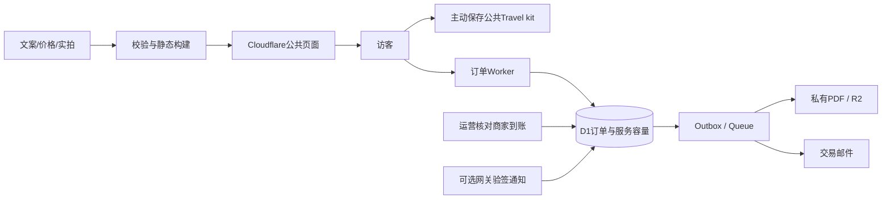

# CQLocalPal 官网 v1 开发 PRD：远程支持优先

日期：2026-11-04｜作者：Codex｜状态：交给另一开发AI执行的需求基准；本文未实现、测试或上线网站。

配套必读：[入场与获客方案](2026-11-04-最快入场方案与会议碰撞整理-Codex.md) · [PWA PRD](2026-11-04-PWA开发PRD-v1-Codex.md)。技术研究追溯：[11.03 Codex PRD](2026-11-03-官网PRD-v0.2-Codex.md)。本文件与旧稿冲突时，以本文件为准；不要求开发AI自行折中多个版本。

## 0. 决策摘要与版本覆盖

[判断] 官网完整建设，首期商业入口为 **CNY200远程支持**。其他产品有完整页面和询单能力，履约资源齐备后逐SKU开放订金。PWA与官网同一代码库，不建另一套App。用户不需要注册。

| 旧稿/既有骨架 | 本版决定 |
|---|---|
| 首页主卖首晚¥399 | 主卖¥200远程支持，首晚是重要次入口 |
| Concierge¥199/24小时 | ¥200/订单、1–4人、72小时行中窗口＋一次20分钟免费行前沟通 |
| 无AsiaPay自动接入就不能收任何订单 | **合格商用收款＋人工核销可作为v1真实交易模式**；没有合格通道才禁止收款 |
| PWA暂缓或自动缓存全站 | v1加入；公共资料包白名单，交易与私人信息不缓存 |
| 先做三栈两天赛马 | 已有Astro骨架，继续Astro。先做性能冒烟；完整赛马不阻塞这次最快启动，旧实验可保留作后续决策工具 |
| 未知手机号/域名/汇率写死 | 外部配置缺失时fail closed；不跳转猜测电话，不把测试汇率当行情 |

标记：`[事实]`/`[公开观察]`有来源；`[判断]`是需求；`[假设]`是试运营默认；`[待核实]`为现实输入。未单独标记的“必须/禁止/默认”均为产品要求，不是已经实现的功能。

## 1. 产品定位、目标与成功标准

英文定位：**A real local, one message away.**

服务英语自由行旅客，帮助处理重庆到达前后的App、付款、交通、地址与日常沟通问题。官网的任务是解释范围、展示真实接待者、获取有效需求、承接订金与售后；PWA帮助反复查阅公开行前资料。

- 北极星：28天内发生WhatsApp主动点击或有效询价/预订资料提交的访问数并集 ÷ 合格访问数，目标≥3%。它是意向代理；另统计真正收到的询单与付费订单。
- 分母口径：生产站`/en/`的Plausible visits，排除团队、自动监控和已识别机器人；本版统计需同意，因此≥3%仅代表同意统计的可观测访问，不声称覆盖全部访客。一次visit内各类意向只计一次；真实收到询单与支付在业务账独立记录。
- 业务试验目标`[假设]`：14天3–5单、30天10单真实付费远程支持；测试/熟人/退款单单列。
- 上线硬线：手机性能Lighthouse≥90、4G LCP≤2.5s；无错误付款确认；无占位联系方式；至少一个有真实排班的服务接待者。
- 服务：08:00–24:00北京时间，30分钟真人首响；首批目标达标率≥95%，每次超时均复盘，不能用自动回复当真人首响。
- 预订确认：人工模式在收到付款线索后值守时段30分钟内核对；**核销成功后**PDF/邮件95%在5分钟内发出。用户应提前看到这一区别。

[判断] 服务不是软件随时可用的同义词。没有值守能力时可以上线真实介绍与询单，但不能把未开放产品标为可即时购买。

## 2. 用户与场景

| 用户/时刻 | 任务 | 页面/功能 |
|---|---|---|
| 来渝前，担心App和付款 | 判断¥200能否解决自己的问题 | Concierge详情、范围比较、退款、真人介绍 |
| 社媒看到实用内容 | 免费解决一个具体问题 | 对应攻略；轻量CTA；无需注册下载资料 |
| 飞行/落地暂时无网 | 查已保存的中文词、流程和联系人 | PWA公共Travel kit；私人PDF另存设备 |
| 家庭/怕辣游客 | 判断服务是否适合同行者 | family/non-spicy独立页，先确认边界 |
| 希望包车/私人导游 | 提交需求，等可履约报价 | 私享页/表单；供应商未确认不收钱 |
| 已付订金 | 找确认单、取消、问尾款 | 受保护管理链接，在线订单真值 |

[公开观察] Jay当前有¥200/trip远程服务公开报价；Anjia原始资料含家庭/不辣内容。这支持测试这些入口，**不能推出需求比例或已验证成交量**。出处见[入场方案第4节](2026-11-04-最快入场方案与会议碰撞整理-Codex.md)。

## 3. SKU合同与可售状态

金额在程序中使用整数分。下面除远程支持200元方向来自发起人外，其他定价、时长与限制仍是供开发用的`[假设]`，正式收款前逐SKU核准。

| ID / URL | 价格与范围 | 首期状态与CTA |
|---|---|---|
| `concierge` / `/en/tours/concierge/` | ¥200/订单，1–4人，共用一个沟通群；72小时行中支持，08:00–24:00；一次20分钟免费行前沟通；无接机/到场 | 优先具备条件后`bookable`；`Request local support`→适配/时间→¥100订金 |
| `first-night` / `/en/tours/first-night-chongqing/` | ¥399/人，约4小时，4–6人英语小团；约定共享接机、入住协助、点餐和夜景；餐费/SIM/门票/酒店不含 | 默认`inquiry`；`Ask about your first night`；不假装天天有班 |
| `private` / `/en/tours/private/` | ¥1,600/团·8小时，1–4人，待核准的向导/司机/车辆；餐票/跨市不含 | 默认`inquiry`；`Plan a private day`；明确拟议标准价/书面报价 |
| `first-night-family` / `/en/tours/first-night-family/` | ¥399/人、6岁及以上同价；家庭节奏、休息点、车辆约束；≤5岁/座椅/无障碍先核对 | 默认`inquiry`；`Tell us about your family` |
| `non-spicy-food` / `/en/add-ons/non-spicy-food-tour/` | ¥259/人，2小时，2–6人，4份约定品尝+1饮品；无接机；不等于清真/无过敏原保证 | 默认`inquiry`；`Check dietary fit`；未确认餐厅/host不开付款 |

售卖状态只有：

- `draft`：仅内部预览，不公开索引。
- `inquiry`：公开真实介绍与需求收集；价格若未批准，标`Proposed price — availability and final details to be confirmed`，不生成支付请求。
- `bookable`：经营主体、范围/价格、当班人员、容量、政策、收款均通过检查；才可生成订金。
- `paused`：暂停接新单；已确认订单售后继续可用。

`approvedForSale`旧字段迁移为上述状态与readiness记录，不能只改一个布尔值就绕开付款和履约核验。

远程支持包含最多2次商家短电话（每次≤15分钟），不保证第三方接通；持续口译、代订、代付、医疗法律服务不含。初期同时在服最多3单，按72小时窗口重叠计算容量；不是“没有实体座位就无限接单”。

退款：付费窗口前随时退；窗口内首次实质服务开始30分钟内不满意全退；没有实质交付的订单核实后全退；零购物违约不限30分钟。免费行前沟通不消耗该保证。其他产品从实际开始服务计时。所有退款还覆盖适用的法定权利，最终经营合同由经营方核验。

## 4. 全站信息架构与语言

```text
/                                  -> /en/
/en/                               远程支持优先首页
/en/tours/                         三产品比较＋细分入口
/en/tours/concierge/
/en/tours/first-night-chongqing/
/en/tours/private/
/en/tours/first-night-family/
/en/add-ons/non-spicy-food-tour/
/en/hosts/                         真人服务人员目录（含远程人员）
/en/hosts/{slug}/                   真实个人主页
/en/guide/                         攻略中心
/en/guide/{slug}/                   首批5篇，后至10篇
/en/travel-kit/                    PWA资料包管理与主屏启动入口
/en/travel-kit/{slug}/             专用离线阅读版，noindex
/en/offline/                       无网兜底，noindex
/en/reviews/                       真实评价/诚实空态
/en/reviews/write/                 安全令牌提交，noindex
/en/about/
/en/faq/
/en/contact/
/en/legal/{terms,privacy,cookies,refunds,no-shopping,reviews-policy}/
/en/booking/                       需求/日期/资料/核对
/en/booking/payment/               人工付款说明或托管跳转
/en/booking/return/                在线核验中/结果
/en/booking/manage/                安全链接订单/取消/PDF
/api/*                            订单/询单/核销/状态等
/ops/*                            仅运营授权访问
/ms/ /ko/ /ja/                    路由/文案结构预留，正式未启用时404
```

导航：Local support / Experiences / Meet your local / Guides；页脚Reviews/About/FAQ/Contact/政策。桌面主按钮`Get local support`；手机底栏保留远程服务入口与WhatsApp。付款核对页不展示抢占提交按钮的营销悬浮条。

`en/ms/ko/ja`文案外置，初始只发布en。非英语解锁：连续28天≥30条有效询单中主动选择该语种≥15%；全部销售/交易/政策文本完成母语顾问校对；客服覆盖并通过10种场景测试。马来语`ms`与印尼语`id`不得混同。未发布页面不进hreflang/sitemap，不以英文复制页冒充本地化。

## 5. 逐页面需求与英文文案

### WEB-01 首页

目标：10秒内看懂¥200是什么、谁回复、如何开始。

从上到下：

1. 导航；无强制安装/注册弹窗。
2. Hero：`A real local, one message away.`；短说明`Remote help for your first 72 hours in Chongqing. CNY 200 for a group of up to four.`；主`Get local support`，次`Ask on WhatsApp`。真人环境照未准备好可用授权重庆场景图，不伪造host。
3. 范围短句：`Remote support. No airport pickup or in-person guiding included.`；三币种参考价、¥100订金说明。
4. 信任条：零购物；开始前全退/开始30分钟满意保证；真实回复及值守时段。
5. 六个典型问题：支付设置、通信、路线/楼层、短翻译、点餐、商家沟通；以结果和限制说明，不写“解决所有问题”。
6. How it works：Tell us your dates→Meet your local contact→Confirm the scope and deposit→Get support during your trip。
7. 具名远程接待者简介、语言/值守/备班；链接hosts。
8. 产品区：远程主卡、首晚/私享次卡；family/non-spicy专题链接；每张显示真实可售状态。
9. 最近真实评价与全量链接；无评价显示`We’re welcoming our first guests. Verified reviews follow completed services.`。
10. 三篇重点攻略＋Travel kit下载；末尾CTA和页脚。

手机H1/价/CTA先于大图，首图≤240px高；首屏不堆五个按钮。事件`hero_view,cta_click,whatsapp_click,product_open,kit_open`。

### WEB-02 Concierge：服务清单模板

模块：H1 `Your local contact for the first 72 hours.`→¥200/同行1–4人/范围→日期/时区/值守→包括与不含→一次行前沟通和72h时间线→六个演示场景（标为示例）→具名接待者→退款→评价→FAQ→CTA。

预订前必须能回答：72h起止、与24小时在线的区别、是否到场、是否代付、退款、无WhatsApp怎么办、是否保证银行绑定成功。不要将免费行前沟通算成已经开始付费服务。

移动端CTA`Request local support`；只有审核通过的可售窗口才展示`Reserve: CNY 100`。事件`scope_open,booking_start,availability_view,policy_open`。

### WEB-03 首晚：时间线模板

H1 `A calmer first evening in Chongqing.`→产品状态与¥399拟议/正式价→约4小时相对时间线→接机窗口/延误处理→照片级集合点与中文地址→入住区域/行李/车辆→含与不含→host→退改→评价→FAQ→询单或真实班次订金。

候选服务未落地时清楚写`Tell us your arrival details. We’ll confirm the team, transport and total before payment.`；不说已提供接机，不用倒计时制造库存。已确认小团不足4人不临时涨价，履约或取得同意改期/全退。事件`arrival_details_start,experience_inquiry`。

### WEB-04 私享：报价模板

H1 `Chongqing, at your pace.`→¥1,600/团基准的状态说明→三种方向（城市故事/摄影建筑/慢节奏）→真实专长/人员→8小时例程→车/接送/含不含→日期/人数/兴趣表单→书面报价流程→退款。

主CTA`Plan my private day`；文案`No payment until your route, host and total are confirmed.`。移动单列表单，先显示总价计价单位。事件`private_quote_start,private_quote_submit`。

### WEB-05 两个细分页

| 页面 | 自上而下模块 | 特殊限制/CTA |
|---|---|---|
| family | 家庭场景H1→年龄/范围→步行与每45分钟休息→厕所/座椅/行李→不辣饮食→示例节奏→host/退款→需求表 | 只收年龄段，不收儿童姓名/生日；≤5岁或特殊座椅/行动需求先人工核对；`Plan a gentler arrival` |
| non-spicy | `Flavour without the chilli challenge.`→品尝项目/价格状态→菜品实拍→不辣与过敏区别→步行/集合→菜单替换→退款→需求表 | 严重过敏无可验证保障则拒售；不以“不辣”承诺无过敏原；`Check the food walk for my group` |

事件`family_fit_submit,dietary_fit_check,experience_inquiry`。页面与免费指南分别服务购买/学习意图，不能复制正文只换关键词。

### WEB-06 hosts / 个人主页 / About

hosts目录：真实照片/姓名/角色（remote support或licensed guide，按证据）→英语能力/服务时间→故事与专长→关联产品→备班说明→CTA。远程人员就是v1可以先展示的host，不要求为了上架¥200先造一整个导游团队。

个人主页：肖像、80–120词本人故事、语言/可核验经历、能帮的三件事、产品、真实评价、非保证指定人说明。没有资料时展示诚实招募/筹备空态，不生成AI向导画像或履历。没有真实服务人员时阻断该SKU售卖。

About：`Local knowledge. A person you can reach.`→真实发起缘由→怎么工作→承诺→经营方及合作关系→联系。未知主体不输出TravelAgency资质标记；不展示护照影像。事件`host_open,host_request,credentials_open`。

### WEB-07 攻略中心与5篇文章

中心：First arrival/Getting connected/Food分类→文章卡（摘要、核验日期、作者）→免费Travel kit→软CTA。

文章：50–80词直接答案→核验人/日期→目录→步骤/对比表→实拍→失败与替代办法→官方来源→相关2篇→相关服务。内容正文最大70ch；不弹安装遮罩；核心内容静态HTML输出。

| slug | 英文标题 | 必写内容/不能写什么 |
|---|---|---|
| `first-night-in-chongqing` | Your First Night in Chongqing: A Practical Checklist | 出发前/落地/入住三个阶段；保存中文地址与备用联系方式；不虚构接机集合点 |
| `payments-and-money` | Paying in Chongqing as a Visitor | 商家消费vs个人转账；卡/现金/已核准App方法；失败时替代；不保证所有外卡/商家可用，不照抄旧限额费率 |
| `sim-card-and-internet` | Getting Connected Before and After You Land | 设备兼容/漫游与本地方案/准备步骤；不保证所有eSIM或App能用，不推未经核实SIM套餐 |
| `non-spicy-food-in-chongqing` | Eating in Chongqing If You Don’t Like Chilli | 常用点餐句、店家核对、可替换选项；不辣≠无交叉接触/清真/无过敏原 |
| `airport-to-your-hotel` | From Chongqing Airport to Your Hotel | 航站楼/酒店中文地址/夜间方案/官方交通查询入口；时刻和价格须当地当期核验 |

至少5篇经英语与当地事实双审后可上线；开发阶段可使用明确草稿，`reviewStatus!='approved'`不公开索引。每篇至少一项可执行清单，800–1,400词是指导而非凑字要求。11.24追加亲子、三日路线、住宿区域、火锅点餐、山城楼层导航五篇。事件`article_view,guide_product_click,kit_save_requested`。

### WEB-08 评价 / FAQ / Contact / 法务

- 评价：全量已验证订单评价、新到旧、产品/星级筛选、每页20条、原文与标注翻译、公开回应；不删合法低分，不要求必须凑出4星。无评价不显示均分；发布不等运营回复才允许低分出现。
- 邀请：履约后给每笔订单相同机会；一次性令牌核验，不给评价奖励，不要求Google截图。公开昵称/服务月份，不公开订单号、完整日期和联系方式。
- FAQ：范围、窗口、支付、退款、离线、语言六类；答案复用政策数据，产品页不维护另一份冲突版本。
- Contact：真实WhatsApp、值守、备用邮箱/电话、表单；WhatsApp不可用时能复制号码或换渠道。PWA不解决网络连通性，售前必须确认一个双方可用备用渠道。
- 法务六页：经营主体、生效日期、关键摘要、完整规则、联系/版本；退款页链接订单管理；禁止用“仅供参考”掩盖退款金额和时限。

事件`review_filter,review_source_open,faq_open,contact_submit,policy_open`；私人令牌页面不装第三方统计。

## 6. 预订、人工核销和自动支付

### WEB-09 一套界面、三个明确运行模式

`PAYMENT_MODE='inquiry' | 'manual_merchant' | 'hosted_gateway'`。

- `inquiry`：无获批通道/人员，收有效需求；不出现可用付款码与支付成功按钮。
- `manual_merchant`：**首期首选**。已核准商家通道，运营先确认服务范围与容量，发付款说明，到账后人工核销，系统再生成确认PDF。
- `hosted_gateway`：AsiaPay优先候选；已合格Stripe可作为替代。真实验签回调/服务端查询确认付款。不能因为界面一样就省略通道专属安全协议。

前两种为必须实现；第三种实现provider接口、mock和完整验收用例，拿到商户适用技术包后接实盘。交付报告必须分别列“人工真实可收款”和“自动网关已接入”，不得混称。

### WEB-10 用户流程

1. 产品/日期/人数→适配检查。所有时间明确北京时间，UTC持久化。
2. 称呼、邮箱、WhatsApp可选、偏好语言；远程产品不强制航班/酒店，接机产品才收必要信息；过敏/行动需求另告知并最少化收集。
3. 核对范围、72h窗口/实际行程、主接待者、总价、订金与尾款、收款主体、条款版本；营销同意不默认勾选。
4. 人工模式提交`request_received`，运营审核→`approved_awaiting_payment`，用户看到付款期限及订单参考号。不能一填表就声称已锁定服务。
5. 付到指定经营主体商家通道，客人提交交易参考信息；页面为`Awaiting payment verification`，可联系但不诱导重复付款。截图上传v1不做，用文字参考号减少敏感文件处理。
6. 运营核对商家账：收款主体、时间、金额币种、交易号未使用、服务仍可交付；核销记录经办人和时间→`payment_paid`＋`confirmed`。
7. 系统固定模板生成PDF、发送安全管理链接；页面有凭证入口。邮件失败不回滚付款。
8. 服务结束记录尾款，邀请真实评价；取消与退款走管理链接或真人通道。

### WEB-11 金额、容量与异常

CNY为合同价。USD/EUR仅作参考展示，来源固定采用[ECB公开参考汇率](https://www.ecb.europa.eu/stats/policy_and_exchange_rates/euro_reference_exchange_rates/html/index.en.html)，保存原始日期、来源和换算值；月更、超过35天不显示陈旧外币数字并告警。若ECB给出每EUR对应`rCny`元及`rUsd`美元，则`参考EUR=CNY/rCny`、`参考USD=CNY×rUsd/rCny`；展示四舍五入至2位小数。[事实] ECB明确这些数值用于信息参考，不应充当实际交易汇率。正式三币种验收须有真实来源；不能沿用既有骨架没有出处的7.1/7.8。

¥200远程订单：默认订金100元、尾款100元。若实际获批USD15订金通道开放，必须单独取得通道实际可执行报价或经营方明确批准的固定CNY抵扣金额，核对页让客户确认后锁定；不要复用ECB展示汇率。抵扣以人民币分计，尾款=200元−已约定抵扣额，收单费不得事后减扣抵扣额。没有获批抵扣规则就不开放USD付款；不要声称100元恒等15美元。币种选择与收银台实收一致；汇率变化不改旧订单。EUR不扣款。

人工付款期限默认24小时。到期未核销由运营查账后释放容量；通用商家码可能仍收到迟到付款，**迟到款先人工复核容量，不自动确认**，无法履约则原路全退。告知客户超过期限先联系再付款。自动网关只有在会话确实关闭/最终未支付后释放保留量；不能凭本地倒计时推断供应商不再收钱。

服务容量按窗口重叠做条件写入，`held+confirmed`互斥计数；远程每订单占一个服务容量，首期上限3。数据库原子约束防止并发超额；人工审核与付款核销都有幂等键；运营点击两次不发两份新订单。

| 异常 | 必需行为 |
|---|---|
| 数据库/通道不可用 | 关闭新支付，保留询单；不以静态成功页假装入库 |
| 只有截图/返回URL显示成功 | 仍待核实；只能从商户账/验签回调确认 |
| 两笔同额款/迟到款 | 按交易号核对，不猜；重复款单列全退 |
| 付款成功而无可用接待者 | 不发已确认服务凭证；人工解决或全退，不超卖 |
| PDF/邮件失败 | 已付款状态不倒退；任务1/5/15分钟重试，超限人工处理 |
| 错金额/错币种 | 人工异常队列，未核实不确认，不按客户端价格覆盖 |
| 退款申请 | 立即记录时间；值守30分钟内真人受理，1个营业日内发起原路退款；到账按通道实际时限 |
| 断网/刷新/双击 | 同幂等键重试；页面说状态未知而非失败；不离线队列补交付款 |

### WEB-12 PDF与管理链接

PDF2–4页，固定模板，不用实时LLM。含订单号、服务窗口、真实接待者/备用联系、人数/范围、含不含、原币种实收/抵扣/尾款、退款、零购物、主体/版本。接机订单另含已核验集合照片/地址；远程订单不出现接机承诺。字体嵌入、中文地址可复制、≤1MB。

R2私有存储，下载须授权，临时权限≤15分钟；邮件管理令牌有效7天、可重发、交换后清理URL；`no-store`/`no-referrer`，不放统计。用户可自行保存PDF到文件应用，页面提示本地副本不会自动反映改期/取消，以在线状态为准。PWA不得自动缓存PDF/令牌/订单。

付款状态与服务状态分开，尾款另列：

```text
payment: unpaid / awaiting_verification / paid / refund_requested / refunded / reconciliation_required
service: request_received / approved_awaiting_payment / confirmed / started / completed / cancelled / manual_resolution
balance: due / paid / waived / refunded
```

每次核销、取消、退款、补发记录审计；只有真实退款确认才能`refunded`。尾款付到经营主体商户渠道，现金必须有安排和收据；纯远程客户不默认能当面见面。第三方供应商服务款不混进本订单。

## 7. 组件与交互状态

| 组件 | 字段/规则 | 必须实现的状态 |
|---|---|---|
| Button | 动作用button，导航用a；触控≥44px，高48px | 默认/hover/focus/loading/disabled，禁用附近写原因 |
| ProductCard | 价/单位/窗口/远程或pickup/状态/CTA | 可询单/可售/暂停/无图；不以假库存代替状态 |
| Price | CNY正式价＋USD/EUR参考/日期＋每人/每单 | 汇率过期、未核价、报价有效期；不能隐藏必付费用 |
| TrustBar | 退款、零购物、真人时段，政策可点 | 在线值守/非值守；不做假“绿色永远在线” |
| HostCard | 真实姓名/角色/语言/肖像授权/介绍 | 已核验/不可约/空态，无AI真人头像 |
| ReviewCard | 原文、验证、月份、回应/来源 | 0条不显示均分；筛选空态可清除 |
| Form | 永久label、错误描述、自动填充、长度限制 | 输入/提交/失败保留非敏感数据/成功；不存健康数据到localStorage |
| BookingSummary | 版本、窗口、范围、金额、主体 | 待审核/待核销/已确认/需人工处理；状态无颜色也能辨认 |
| OfflinePack | 包大小/版本/日期/内容清单 | 未保存/保存中/完整/部分失败/过期/被清理/删除，见PWA PRD |

手机320px无横向溢出、正文≥17px；安全区不遮按钮；键盘弹出不盖错误/提交；所有表单可键盘完成。空态与错误文案使用外置字典。

## 8. 信任、SEO与数据

信任分布：首页见范围、三币种、退款、真人；产品页CTA旁见完整含不含/政策；host页见真实角色；核对页见主体/价/版本；确认PDF见承诺与联系；评价页公开全量与回应。零购物不靠返佣强迫购买；转介绍将来若有佣金须另明确披露，不能一边有推荐佣金一边宣称所有业务永不收任何佣金。

SEO：静态正文、title/description/OG/单H1、自canonical、真实404、固定尾斜杠301规范、sitemap仅已发布200页。四语种按真实等价页hreflang互链，`x-default`英语；未发布语言无hreflang。数据用Organization、真实Person、Service/Offer、Article/BreadcrumbList；有经营资格资料才输出TravelAgency。自营评价不用于伪造LocalBusiness富摘要星级，FAQ显示但不保证搜索富结果。

统计：Plausible Cloud Business单一访问分析＋Search Console；真实收入/退款取订单账。非必要统计同意后加载，同等显著Accept/Reject。统计拒绝不妨碍咨询或付款。

事件最小集：`page_view,cta_click,whatsapp_click,lead_intent,inquiry_received,booking_requested,checkout_started,deposit_verified,booking_confirmed,refund_requested,refund_completed,review_published,kit_save_requested,kit_save_completed,kit_save_failed,kit_open,install_guide_open`。不传姓名、联系方式、订单号、完整URL查询串、支付参考号。`lead_intent`按有此事件的visits取并集；安装/指南下载不算旅行询单。

## 9. 技术路线与数据流

[判断] 沿用Astro SSG＋TypeScript strict＋原生scoped CSS/design tokens＋Markdown/JSON Content Collections；不为PWA改成全站React SPA。已有Astro版本先按lockfile验证，开发前记录实际版本；升级单独验证，禁止浮动latest部署。

- Cloudflare Workers Static Assets/CDN托管公共页面；小型Worker承接表单/订单/管理。
- D1保存订单、服务窗口容量、核销/退款/评价；Queues/outbox处理PDF和邮件；R2私有文件；Resend交易邮件。
- `/ops`以Cloudflare Access限定具名运营账号；本版需班次/窗口、订单核销、尾款/退款、评价回应四个表，不做游客账户系统。
- 内容Git管理，AI编辑→浏览器预览→创始人批准→构建发布；普通内容更改不改旧订单快照。
- PWA用Workbox构建期`injectManifest`＋单一明确Service Worker，具体缓存边界见独立PRD；不再叠加第二套PWA插件/SW。



页面、支付与PWA是同站三个责任边界。离线包不得接收D1订单数据，营销访问不依赖数据库在线。

### 数据最低契约

| 实体 | 最低字段 |
|---|---|
| Product | id、slug、template、status、priceCnyMinor、priceUnit、priceVersion、partyLimits、serviceWindowHours、inclusions、exclusions、readiness、policyVersion |
| ServiceSlot | id、skuId、startAtUtc、endAtUtc、hostId、backupHostId、capacity、status；远程按重叠区间计算 |
| Order | id、skuId、slotId、partySize、contactEncrypted、scopeSnapshot、priceSnapshot、policySnapshot、paymentMode、paymentStatus、serviceStatus、balanceStatus、version、createdAt |
| Receipt | provider、merchantId、transactionRef、amountMinor、currency、verifiedBy、verifiedAt、orderId；商户＋交易号唯一 |
| PriceSnapshot | totalCnyMinor、depositCurrency、depositAmountMinor、displayFx/source/date、paymentFxOrCreditApproval、creditCnyMinor、balanceCnyMinor；不可随内容更新改变 |
| Outbox | id、orderId、jobType、version、status、attempt、nextAttemptAt；与确认状态同事务写入 |
| Inquiry | id、skuId、datesOptional、partySizeOptional、preferredLanguage、contact、consentToReferral=false、sourceCode、status |
| Review | id、privateOrderId、skuId、hostId、rating、body、publicName、serviceMonth、consent、response、publishedAt；私有字段不出快照 |

接口：`GET /api/availability`只返回公开可售状态；`POST /api/booking-requests`返回请求编号而非已付款；`POST /api/inquiries`收真实询单；`POST /api/bookings/status`需安全授权；`POST /api/bookings/cancel`防CSRF；`POST /api/ops/receipts/verify`需管理员授权/唯一交易号；`POST /api/payments/notify`仅启用网关时按商户协议验签；`POST /api/manage-link`统一响应防枚举。金额/状态/人员不能由客户端任意指定。

数据库条件写入与batch事务必须处理“影响0行不等于报错”，未取得容量不得创建付款请求。外部支付/邮件调用在数据库事务外，通过幂等与outbox衔接。

### 建议目录

```text
web/src/{layouts,components,styles,scripts}/
web/src/pages/en/{tours,hosts,guide,travel-kit,booking,legal}/
web/src/content/guides/{en,ms,ko,ja}/
web/src/data/{products,prices,reviews.public}.json
web/src/i18n/{en,ms,ko,ja}.json
web/src/pwa/                     SW源与资料包逻辑；详见PWA PRD
web/scripts/                    发布检查、离线资产清单
worker/src/{routes,domain,providers,jobs}/
worker/migrations/
shared/schemas/
ops/{content,service,payment,refund,recovery}.md
```

产品价唯一存products；prices只存参考汇率，不能重复硬编码各页面价格。主生产发布要有配置检查；品牌名、域名、对外电话、收款主体从同一配置来源。

### 费用、维护与备选

[事实] 2026-11-04查看的[Cloudflare官方定价](https://developers.cloudflare.com/workers/platform/pricing/)列Workers付费计划最低USD5/月，静态资产请求有免费规则；不能把它理解成D1/R2/队列及一切用量永远零成本。[Resend官方](https://resend.com/pricing)目前列Free每月3,000封、每天100封；开启生产域名验证并关闭打开/点击跟踪。Plausible选Business是为了属性/漏斗和后续业务分析；[官网](https://plausible.io/)当前10k页面浏览档展示USD19/月，月付/年付及最终结账金额以开通时为准，本文不自动购买。

[假设] 低流量首期为基础托管、存储、邮件和分析预留**USD30–80/月**；不含域名、AI开发订阅、人工、顾问/影像、收款费与税。PWA复用现有托管，增加开发/测试和少量静态流量，不另开一套服务器。开发报告须列实际选用计划、资源限额与告警，不能引用估算当账单。

[判断] Next.js不作为本轮备选实施：内容/询单/独立订单接口并不要求全站服务端React，已有Astro骨架与本次PWA均可满足；除非原型证实具体需求无法实现，不因“PWA像App”改框架。基础备选是保留Astro页面、暂用人工订单SOP；数据库/邮件故障时暂停新支付但继续真实询单，不将金钱状态降级为浏览器本地状态。各栈竞品证据、Lawson局限及两天赛马方法沿用11.03 PRD技术章，本轮不声称执行过赛马。

境内首次访问性能必须另做重庆实际移动网络测试，同时测海外目标客源访问；全球CDN品牌不等于每个境内网络实测达标。PWA解决已保存资料的后续可用性，不能修复从未加载过页面的网络失败。


## 10. 视觉方向与性能

**DESIGN SPECIFICATION**：首页/产品属Persuade，攻略属Read，预订/资料包属Operate。沿用Riverlight Journal“高级旅行手记”：暖纸`#F6F3EC`、墨绿`#173C32`、炭黑`#202622`、陶土`#A64531`、浅砂`#D8CEBD`；标题Instrument Serif，正文Source Sans 3，本地WOFF2。英文正文17–18px、行高1.6、阅读70ch；H1桌面64px/手机40px。

一个1200px容器、桌面12列、640/960/1280三个断点、4/8/12/16/24/32/48/64/96间距。首页文字5列/真实环境图7列，图向右延展表现重庆空间层次；操作/阅读页使用稳定单列。无首屏视频、滚动劫持、旋转轮播；动效仅150–200ms反馈且尊重reduced-motion。图标只用按需内联Lucide，不用emoji代替。

首页线框：导航→非对称¥200 Hero→范围/信任条→六类问题→四步服务→真实接待者→主次产品→评价→指南与Travel kit→CTA/主体页脚。手机：短标题/价/CTA→图→范围→信任→服务与真人；安装入口在Travel kit，不抢主页主CTA。

| 预算/体验 | 验收 |
|---|---|
| Lighthouse移动 | 性能/无障碍/最佳实践/SEO四项≥90，公开营销页各5次中位数 |
| LCP/CLS | 约1.6Mbps、150ms RTT、CPU4倍降速；LCP≤2.5s、CLS≤0.1；至少4/5次LCP达线 |
| 客户端JS | 首页/攻略目标≤30KiB gzip，任一营销/预订页≤80KiB；PWA下载后资源另列不可藏账 |
| 首屏 | 总传输≤500KiB，首图≤180KiB，CSS≤20KiB gzip，本地字体合计≤70KiB |
| 订单体验 | 核对与提交≤4分钟；人工核销等待单列，不伪装为即时确认 |
| PWA | 外加资料包≤3MiB完整离线，按独立PRD验收，不以已废弃/变动的Lighthouse PWA徽章作唯一标准 |

## 11. 隐私、安全与运营维护

不收卡号/密码/护照照片，航班信息限相关产品。过敏/行动信息告知用途、最少收集；公共仓库不放客户资料。交易与健康信息不进PWA/分析/公共PDF快照。管理API授权、防CSRF/重放、限流、密钥只在服务器；回调与人工核销都不能从客户端信任金额。

运营API除Access入口外还须验证Access JWT的签名/issuer/audience，禁止直接Worker域名绕过权限；角色区分查看与核销/退款。管理令牌采用至少256位密码学随机值，数据库只存hash，短期换受保护会话并可撤销；解密密钥保存在服务端secret，`contactEncrypted`不得只是base64。邮件关闭打开/点击跟踪，避免管理链接进入追踪服务。

取消入口易找；原币种本金原路退，不以代金券代替。经营范围/合同/隐私/跨境处理由经营方核验；不宣称“静态站/境内尾款/不收卡”就自动合规。评价零激励。

保留默认`[假设]`：未成交线索90天、敏感需求服务后30天、安全日志14天；交易法定留存配置由经营方确定，不编造固定年限。公开评价依授权管理。人工核销凭据仅私有账，不进Git。

每日09:00核对待核销、收钱未确认、确认未发PDF、退款未完成、超时询单。备份D1和私有文件；恢复目标RPO≤24h/RTO≤4h，支付商账补齐缺口。AI改内容后创始人只看预览，不要求手写SQL/MDX。

## 12. v1验收用例

| AC | 场景与必须结果 |
|---|---|
| 01 | 首页突出¥200/72h/1–4人/远程不接机；全站没有遗留¥199/24h冲突 |
| 02 | 所有页面树链接可达，未知路由真实404，未发布语种不进sitemap |
| 03 | `inquiry`产品不生成支付；缺真实联系方式/主体时生产检查失败，不跳假号码 |
| 04 | 远程窗口容量3，第四个重叠申请不能自动确认；并发核销不超额 |
| 05 | 人工模式只有经商户账核实才确认；截图/自报成功/URL参数不能改变paid |
| 06 | 同一交易号不能核销两订单；重复按钮不重复确认/发新凭证 |
| 07 | 迟到付款、错币种、付款后不能履约进入人工处理；退款可追踪 |
| 08 | PDF/邮件失败不抹掉付款；能补发、下载；私人资源无公开URL和PWA缓存 |
| 09 | ¥100订金/尾款¥100；USD15分支汇率锁定、退款同原币种；未授权币种不可选 |
| 10 | 随时退/30分钟/零购物规则可执行；退款受理和完成不是一个状态 |
| 11 | 0评价、筛选无结果、host资料不足均有真实空态；不造评分与身份 |
| 12 | 拒绝统计仍能提交/付款；来源码不包含PII；转介绍同意默认false |
| 13 | 手机320/390px、桌面1440px、键盘/200%放大、Safari/Chrome完成主要流程 |
| 14 | 五篇攻略有核验日期与来源；正文/价格/政策无需JS可读；营销页性能达线 |
| 15 | PWA独立PRD全部P0通过，安装不是咨询/支付前置条件 |
| 16 | 创始人通过AI改一处价格/host故事并预览发布，旧订单快照不变，能回滚 |

自动测试聚焦金钱、容量、权限、离线与更新；视觉用截图/真机。交付原始构建、类型检查、关键测试、Lighthouse JSON与真机记录；没测的必须标未测。

## 13. 排期与交付清单

- **48小时启动入口**`[假设]`：同一网站先交付Concierge说明、真实联系、范围/退款、人工订单SOP；不另造临时代码库。
- **11.14**：首页＋Concierge英雄页，首晚页同步预览；页面性能/真人联系可用。
- **11.17**：完整页面树、5篇核验攻略、人工订金/核销/PDF/退款、轻PWA正式验收。若外部资料缺失，相应真实售卖未通过；技术演示与实盘分开列。
- **11.24**：10篇攻略、服务复盘、供应商洽谈，按真实需求决定下个可售SKU。

开发交付：源码/锁版本、环境变量样例、部署与回退说明、数据库迁移、测试报告、内容编辑说明、人工核销/退款SOP、PWA缓存矩阵与真机录屏/截图、未完成外部输入清单。

现实输入：实际域名/WhatsApp/邮箱、经营与收款主体、商家码及许可、真实主/备接待者、价格/范围批准、照片授权、条款核验。未取得时用明确测试配置开工，生产fail closed。AI无需再问流程怎么设计，但不能伪造现实账号和授权。

## 14. 非目标与已有骨架交接注意

v1不做游客账户/App/小程序/聊天机器人/AI行程编辑器/推送/全站离线/离线下单/地图瓦片离线包/票务代售/多城市/导游自由入驻/复杂佣金结算。社媒账号实际注册、内容拍摄、供应商合同属于运营交付，不冒充代码功能。

[公开观察] 本次只读抽查既有`web/`骨架发现以下开发必须复查的点；这不是已修复声明：

1. `src/config.ts`有示例手机号、未核实主体/邮箱；必须改配置门槛，禁止直接发布。
2. 首页仍主推首晚、保留¥199；按本版改主入口及统一SKU数据。
3. `prices.json`参考汇率没有可追溯原始来源；不得当实际行情。
4. `public/sw.js`预缓存包含booking，导航通配缓存同源页面，断网未知页回首页；必须整体按新PWA缓存矩阵实现，禁止把私人交易带入公共缓存。
5. 旧SW删除全部非当前名缓存、无条件skipWaiting、用allSettled掩盖部分预缓存失败；需要作用域清理、更新提示、完整性状态。
6. `Base.astro`远程Google字体依赖不利离线，且localhost不注册SW；按生产构建预览测试，并本地托管字体。
7. 本次未完整运行/审查全部代码、未检查实际线上部署。开发AI先确认工作区最新状态，保留其他人的修改，再按验收补齐缺页和流程。

[判断] 这次“完整”指页面、状态、真实交易责任和离线边界完整；不是把未经准备的服务一口气开放收款。
